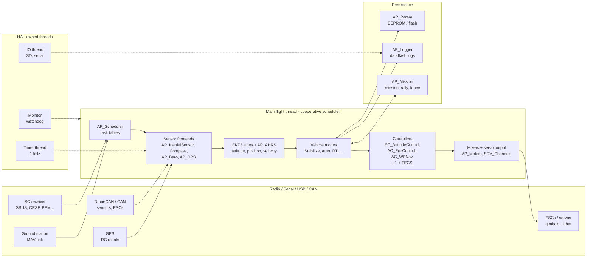

# ArduPilot Firmware Architecture Analysis

> Deep dive into the architecture of [ArduPilot](https://github.com/ArduPilot/ardupilot) — the open-source autopilot software suite for multirotors, fixed-wing aircraft, rovers, submarines, blimps and antenna trackers.

This repository documents how the ArduPilot firmware is organized, how data flows through it, and where to change what. The goal is to give programmers and contributors an accurate mental model of the codebase.

**All paths in this analysis are relative to [`ardupilot/`](../ardupilot) and reference the source tree at commit `e96bd9053e` (tag `ArduPilot-4.6.0-beta1`, firmware version `4.8.0-dev`, master-era code).**

## Table of Contents

| # | Document | Description |
|---|----------|-------------|
| 1 | [Architecture Overview](docs/01-architecture-overview.md) | High-level layering, module map, naming conventions, core design patterns |
| 2 | [HAL & Platform Abstraction](docs/02-hal-and-platforms.md) | AP_HAL interfaces, ChibiOS/POSIX backends, the `hal` object, threading model |
| 3 | [Boot & Startup](docs/03-boot-and-startup.md) | Power-on to ready: `main()`, `hal.run()`, `AP_Vehicle::setup()`, `init_ardupilot()` |
| 4 | [Scheduler & Real-Time Loop](docs/04-scheduler-realtime-loop.md) | Cooperative task scheduler, task tables, tick arithmetic, load adaptation, watchdogs |
| 5 | [Vehicle Layers](docs/05-vehicle-layers.md) | Copter/Plane/Rover/Sub/Tracker/Blimp classes, mode systems, arming, failsafes |
| 6 | [Sensors & State Estimation](docs/06-sensors-and-state-estimation.md) | Frontend/backend drivers, EKF3, multi-core lanes, AP_AHRS, AP_DAL replay |
| 7 | [Flight Control Pipeline](docs/07-control-pipeline.md) | Pilot RC → attitude control cascade → motor mixers → servo output |
| 8 | [GCS & Communications](docs/08-gcs-and-communications.md) | MAVLink GCS, streams, routing, serial manager, telemetry, RC protocols, DroneCAN |
| 9 | [Missions & Autonomy](docs/09-missions-and-autonomy.md) | AP_Mission grammar and state machine, rally, fences, obstacle avoidance, payloads |
| 10 | [Parameters, Storage & Logging](docs/10-parameters-storage-logging.md) | AP_Param system, StorageManager, dataflash logs, deterministic replay |
| 11 | [Scripting, UI & Peripherals](docs/11-scripting-interfaces-peripherals.md) | Lua scripting, AP_Module, notify/OSD, external AHRS, AP_Periph CAN nodes |
| 12 | [Build System & Testing](docs/12-build-system-and-testing.md) | waf build, boards, generated protocol code, SITL, autotest, CI |

## Tech Stack

- **Language**: C++11 (`-std=gnu++11`, heavy C-style embedded idioms), no dynamic allocation in flight code on ChibiOS targets, `constexpr`/templates used sparingly
- **RTOS**: ChibiOS on STM32 boards; plain POSIX (Linux, SITL, QURT), ESP-IDF (ESP32), plus WASM experiments
- **Frameworks**: MAVLink v2, DroneCAN (libcanard), Lua 5.3.6 (scripting), littlefs (flash filesystem), googletest (unit tests)
- **Parallelism**: one flight thread (`loop()`) plus fixed HAL-owned threads (timer, IO, monitor, RC in/out) — vehicles are **cooperatively scheduled**, never preempted by other ArduPilot code
- **Estimation**: EKF3 (24-state, one lane per enabled IMU), legacy EKF2, DCM fallback
- **Build**: Python `waf` (with ArduPilot-specific extensions), board definitions as data files (`hwdef.dat`), protocol code generated inside the build (MAVLink, DroneCAN)
- **Tests**: googletest unit tests (27 `libraries/*/tests` dirs), Python-driven SITL integration suites (`autotest`, ~160 test classes), plus `Tools/Replay` for deterministic log replay of the EKF

## Source Stats

- `libraries/`: **155 library directories**, ~2,850 C++ source files (incl. examples), **~729,000 lines** of code
- Vehicle programs: ArduCopter **92 files** (~30k lines), ArduPlane **86** (~32k), Rover **52** (~11k), ArduSub **50** (~12k), Blimp **39** (~7k), AntennaTracker **27** (~3.5k)
- One codebase compiles **six different vehicles** (plus the heli build) into **~500 board targets**: **460 ChibiOS** hwdefs, 25 Linux, 10 SITL, 10 ESP32, 2 QURT
- ~437 build `--enable/--disable` feature options generated from a single table (`Tools/scripts/build_options.py`)
- **161** Lua example scripts in `libraries/AP_Scripting/examples/`
- A typical ArduCopter build exposes **on the order of 1,000–1,300 parameters** to a ground station

## The System at a Glance

ArduPilot is a **library-centric autopilot**: almost all logic lives in vehicle-agnostic libraries under `libraries/`, and each vehicle directory (`ArduCopter/`, `ArduPlane/`, …) is a thin composition layer that wires those libraries together and adds vehicle-specific mode logic. Everything runs on a **cooperative scheduler** paced by IMU samples, on top of a hardware abstraction layer (HAL) that hides the RTOS and board differences.



## Why This Analysis?

ArduPilot is one of the largest actively-maintained open-source embedded projects in existence. It combines:

- A **hardware abstraction layer** that ships one codebase on ~500 boards across six platform families (ChibiOS, SITL, Linux, ESP32, QURT, WASM), with zero vendor-SDK leakage into portable code
- A **library architecture** where ~155 reusable subsystem libraries are composed differently by six vehicle programs sharing one `AP_Vehicle` base class
- A **cooperative real-time scheduler** that guarantees the attitude control chain runs on every IMU sample while dozens of rate-limited tasks fill the slack
- A **parameter system** where every library exposes its configuration as self-describing persisted parameters — the universal configuration interface of the whole project
- An **estimator stack** (EKF3) designed for deterministic replay from flight logs via a dedicated data-abstraction layer (AP_DAL)

If you are a firmware engineer, a robotics developer or a contributor, there is a lot to learn here regardless of whether you work on drones, real-time systems or portable embedded architecture.

## Repo Layout

```
ardupilot/
├── waf / wscript          # Build system (Python waf + ArduPilot extensions)
├── modules/               # Git submodules: ChibiOS, waf, mavlink, DroneCAN, gtest, ...
├── libraries/             # ~155 shared subsystem libraries (the real code!)
│   ├── AP_HAL/            # Abstract hardware interfaces (UART, GPIO, SPI, ...)
│   ├── AP_HAL_ChibiOS/    # STM32/ChibiOS backend + 460 board definitions (hwdef/)
│   ├── AP_HAL_SITL/       # Software-in-the-loop backend (POSIX)
│   ├── AP_Vehicle/        # Shared vehicle base class, common scheduler tasks
│   ├── AP_InertialSensor/ # IMU frontend + 19 chip drivers
│   ├── AP_Compass/        # magnetometer frontend + 23 drivers
│   ├── AP_Baro/           # barometer frontend + 21 drivers
│   ├── AP_GPS/            # GPS frontend + ~15 protocol drivers
│   ├── AP_NavEKF3/        # 24-state Extended Kalman Filter (EKF3)
│   ├── AP_AHRS/           # attitude/position interface over the EKF
│   ├── AC_AttitudeControl/# attitude + position controllers (multicopter)
│   ├── AC_WPNav/          # waypoint/loiter/circle trajectory generation
│   ├── AP_Motors/         # motor mixers (matrix, heli swash, 6-DOF, ...)
│   ├── SRV_Channel/       # SERVOx_FUNCTION output routing
│   ├── RC_Channel/       # RC input scaling and aux switches
│   ├── AP_Scheduler/      # the cooperative task scheduler
│   ├── AP_Param/          # parameter system (var_info tables, persistence)
│   ├── StorageManager/    # EEPROM/flash area partitioning
│   ├── AP_Logger/         # dataflash logging
│   ├── AP_Mission/        # mission command engine
│   ├── GCS_MAVLink/       # MAVLink ground-control stack
│   ├── AP_Scripting/      # embedded Lua interpreter + generated bindings
│   ├── AP_DroneCAN/       # CAN support (libcanard) + AP_Periph pieces
│   ├── SITL/              # 163 simulator model files (aircraft, sensors, battery)
│   └── ...                # ~130 more: mounts, cameras, fences, telemetry, ...
├── ArduCopter/            # multicopter + helicopter program ("arducopter", "arducopter-heli")
├── ArduPlane/             # fixed-wing program ("arduplane")
├── Rover/                 # rover + sailboat program ("ardurover")
├── ArduSub/              # submarine ROV program ("ardusub")
├── AntennaTracker/       # antenna/mount tracker program ("antennatracker")
├── Blimp/                # indoor blimp program ("blimp")
├── Tools/                # autotest framework, AP_Periph, bootloaders, scripts, Replay
├── tests/                # shared test helpers (gtest / pytest)
└── docs/                  # Doxygen generation config only
```

## License

ArduPilot firmware is licensed under the GPLv3 open-source license.
This analysis is for educational purposes and is not part of ArduPilot itself.