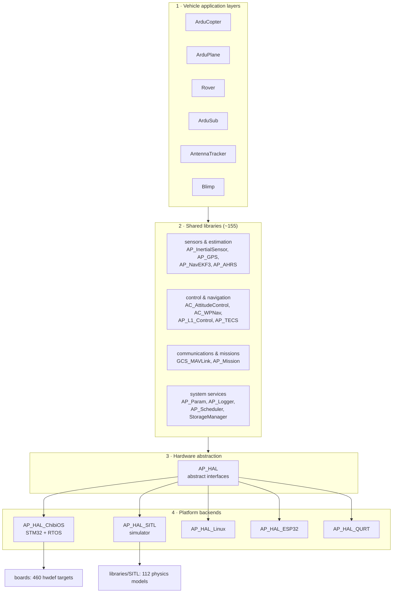
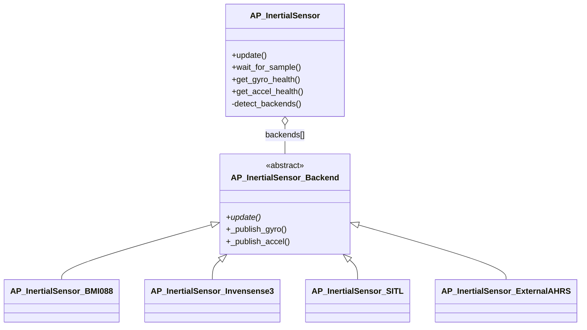

# 01 · Architecture Overview

High-level system architecture, module map, layering and the design patterns that repeat across the whole codebase.

**[← Back to index](../README.md)**

---

## What ArduPilot Is

ArduPilot is a family of autopilot programs ("firmware") built from **one shared library collection**. The same `libraries/` tree powers:

| Program | Binary name | Vehicle | Default loop rate |
|---|---|---|---|
| `ArduCopter/` | `arducopter` (and `arducopter-heli`) | multicopters + helicopters | 400 Hz |
| `ArduPlane/` | `arduplane` | fixed-wing, VTOL quadplanes | 50 Hz |
| `Rover/` | `ardurover` | ground rovers, sailboats | 50 Hz |
| `ArduSub/` | `ardusub` | underwater ROVs | 400 Hz |
| `AntennaTracker/` | `antennatracker` | pan/tilt antenna trackers | 50 Hz |
| `Blimp/` | `blimp` | indoor buoyant airships | 50 Hz |

Each is a thin application layer over the same sensors, estimation, control, communication and mission libraries. A typical vehicle directory contains only modes, arming checks, GCS overrides and parameter declarations — the "hard" logic is in `libraries/`.

## The Four Layers

**Dependency rule:** arrows only point downward. A library never includes a vehicle header; the HAL never includes a library header. The build enforces this (an `ArduCopter_libs` static library compiles each library with `ap_vehicle=ArduCopter`, so a library can be specialized per vehicle *via defines*, never by including vehicle code).

## Module Map by Prefix

The first letters of a library name tell you what it is — this is a strong, project-wide naming convention:

| Prefix | Meaning | Examples |
|---|---|---|
| `AP_` | "ArduPilot" — generic library, usable by (almost) any vehicle | `AP_GPS`, `AP_Mission`, `AP_Logger` |
| `AC_` | "ArduCopter" lineage — multicopter control stack (still usable by Sub/Blimp/QuadPlane) | `AC_AttitudeControl`, `AC_WPNav`, `AC_PID` |
| `AR_` | "ArduRover" lineage — ground-vehicle control stack (but note: the `AR_*` *parameter* prefix is also used by helicopter autorotation, e.g. `AR_HS_SET_PT`) | `AR_WPNav`, `AR_Motors` |
| `APM_` | fixed-wing control (plane) | `APM_Control` (roll/pitch/yaw/steer controllers) |
| `GCS_` | ground-control stack | `GCS_MAVLink` |
| `AP_HAL*` | hardware abstraction family | `AP_HAL_ChibiOS` |
| `SITL` | simulator | `SITL/SIM_Aircraft` |

The parameter namespaces follow the same logic: `ATC_*` (attitude control), `PSC_*` (position control), `WP_*` (waypoint nav), `MOT_*` (motors), `EK3_*` (EKF3), `SRx_*` (MAVLink stream rates), … Prefixes are assigned in each vehicle's `Parameters.cpp`, not inside the libraries — a library declares *relative* names (e.g. `_RLL` "roll") and the vehicle prefixes them (`ATC_ANG_RLL_P`).

## The Core Design Patterns

ArduPilot's size (~824,000 LOC) is managed with a small set of repeating patterns. Learn these once and every library reads the same way.

### 1. Frontend + Backend (sensor & device drivers)

Almost every sensor/device library splits into:

- a **frontend** — one class holding parameters, instances and calibration, exposing the API vehicles use (e.g. `AP_InertialSensor` via `AP::ins()`);
- a **backend base** — abstract class (`AP_InertialSensor_Backend`) with a virtual `update()`;
- **many concrete drivers** (`AP_InertialSensor_BMI088`, `AP_InertialSensor_Invensense`, …), discovered by `probe()`/detect functions at startup and registered into numbered *instances* (`INS1`, `INS2`…).

The same shape appears in `Compass`, `AP_Baro`, `AP_GPS`, `RangeFinder`, `AP_RangeFinder`, `AP_Mount`, `AP_Frsky_Telem`, `AP_MSP`, `AC_PrecLand`, `AP_OSD`, `AP_Notify`, … — anywhere a "type" parameter selects a driver.

### 2. Vehicle-agnostic library + thin vehicle adapter

Libraries contain all generic logic and call back into vehicles through **functors** (callback objects) instead of virtual interfaces. Example: `AP_Mission` is completely generic; each vehicle passes three callbacks — `start_command`, `verify_command`, `mission_complete` — when constructing it. The vehicle's `ModeAuto::start_command()` (copter) or `Plane::start_command()` (plane) is a small `switch` that translates generic mission commands into vehicle actions.

### 3. Composition + `friend`

Vehicle classes own their library objects as *members* and grant GCS/arming/mode classes access via C++ `friend` declarations rather than getter explosion (`Copter.h` friends the entire GCS, arming and mode stack). Unusual, deliberately pragmatic.

### 4. Parameters as data (`var_info` tables)

Every configurable value is an `AP_Float`/`AP_Int32`-style member described in a static `var_info` table (offset + name + default). One declaration drives persistence, MAVLink access, ground-station docs and unit tests. Detailed in [10 · Parameters, Storage & Logging](10-parameters-storage-logging.md).

### 5. Compile-time feature gating

Every optional subsystem is fenced with `AP_XXX_ENABLED` defines (e.g. `AP_GPS_ENABLED`, `AP_SCRIPTING_ENABLED`) generated from ~437 build options. Vehicle code mirrors them (`MODE_AUTO_ENABLED = AP_MISSION_ENABLED`) with `#error` consistency checks — this is how 155 libraries fit on a 2 MB flight controller.

### 6. Singletons

Global subsystem accessors (`AP::ins()`, `AP::ahrs()`, `AP::logger()`, `gcs()`, `AP::motors()` …) return pointer/references to objects constructed once. This keeps the HAL-independent code free of static order problems and lets scripting/tests replace them in the same process.

## Runtime Shape (preview)

At runtime an ArduPilot vehicle is: **one main flight thread** running a fixed, priority-ordered table of rate-based tasks (`AP_Scheduler`), **a handful of HAL-owned threads** (timer, IO, monitor, RC in/out) and **a Lua VM thread**. The main loop is paced by IMU samples; the attitude control chain runs on *every* sample (400 Hz by default on Copter/Sub), everything else is time-sliced in the slack.

Deep dives: [03 · Boot & Startup](03-boot-and-startup.md) and [04 · Scheduler & Real-Time Loop](04-scheduler-realtime-loop.md).

## Reading Map

| If you want to… | Read |
|---|---|
| add a sensor driver | [06 · Sensors](06-sensors-and-state-estimation.md) + the `*_Backend` classes of your target library |
| add/change a flight mode | [05 · Vehicle Layers](05-vehicle-layers.md) + [07 · Control Pipeline](07-control-pipeline.md) |
| understand the estimator | [06 · Sensors](06-sensors-and-state-estimation.md) |
| add a MAVLink message handler | [08 · GCS & Communications](08-gcs-and-communications.md) |
| add a mission command | [09 · Missions](09-missions-and-autonomy.md) |
| port to new hardware | [02 · HAL](02-hal-and-platforms.md) + [12 · Build System](12-build-system-and-testing.md) |

## Navigation

**[← Back to index](../README.md)** · Next: [02 · HAL & Platform Abstraction](02-hal-and-platforms.md)