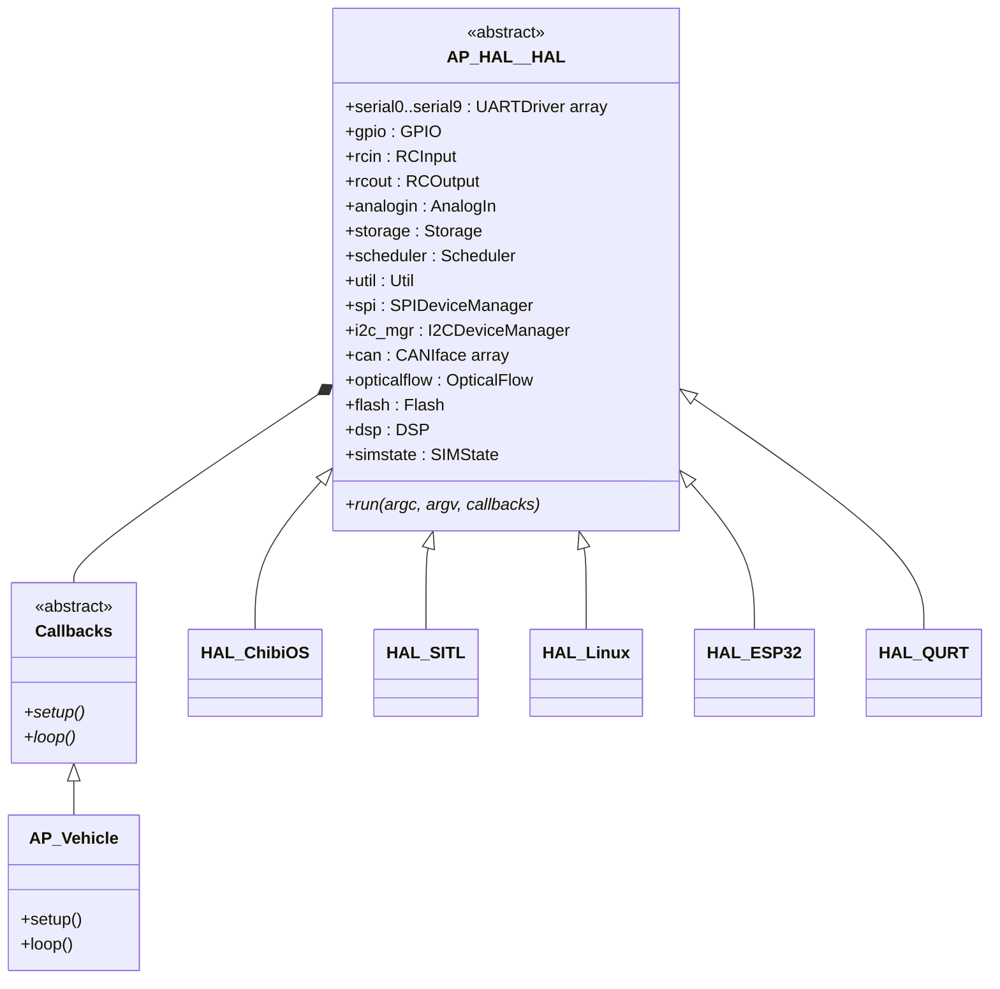
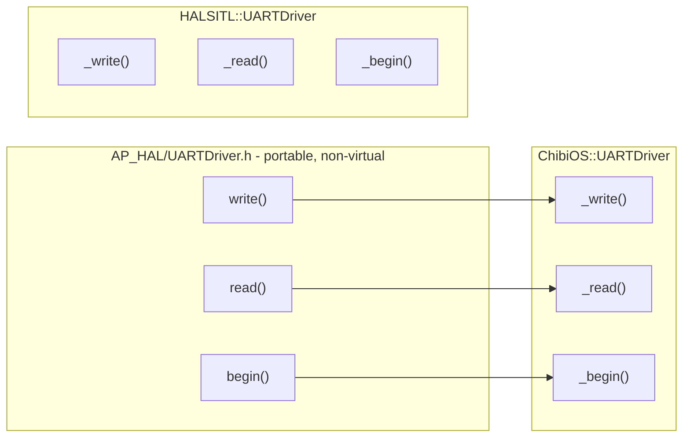
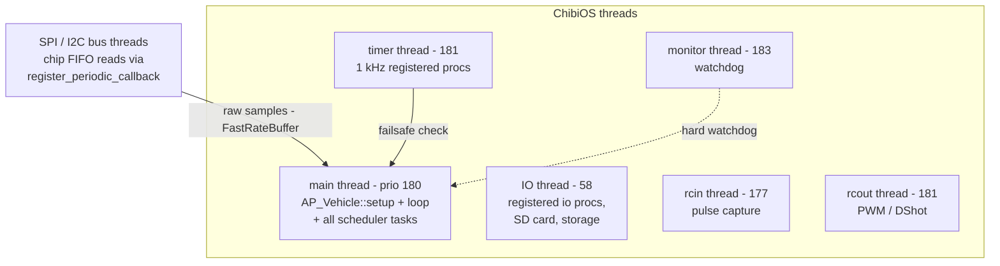

# 02 · HAL & Platform Abstraction

The `AP_HAL` family: abstract hardware interfaces, the global `hal` object, the ChibiOS and SITL backends, board definitions, and the threading model.

**[← Back to index](../README.md)**

---

## Why a HAL?

ArduPilot runs on hundreds of boards: STM32F4/F7/H5/H7 (ChibiOS RTOS), Linux SBCs, ESP32, Qualcomm QURT, and as a native desktop process for simulation. [`libraries/AP_HAL/`](https://github.com/ArduPilot/ardupilot/tree/e96bd9053e/libraries/AP_HAL) defines the **portable side** of every hardware touchpoint; each `AP_HAL_<Platform>/` implements it. Portable code (all `libraries/AP_*`, `AC_*` and vehicle code) includes *only* `AP_HAL` headers.

The platform is chosen **at build time**: your board's `hwdef.dat` sets `CONFIG_HAL_BOARD`, and the selected family's classes are compiled in and wired into a single global object.

## The `hal` Object

Every driver in the platform backend is constructed statically and wired into one `AP_HAL::HAL` object — the **entire platform in one struct**:



- [`libraries/AP_HAL/HAL.h`](https://github.com/ArduPilot/ardupilot/blob/e96bd9053e/libraries/AP_HAL/HAL.h) declares it; `get_HAL()` returns a const reference.
- `HAL_ChibiOS` etc. only override `run()` (process entry); every driver member is a `ChibiOS::UARTDriver`, `ChibiOS::Scheduler`, … defined in the family's own namespace (`ChibiOS::`, `HALSITL::`, `Empty::`).
- Empty slots are filled with `Empty::*` stubs — a board with no optical flow sensor still gets a working `hal.opticalflow` that does nothing. This "graceful degradation" lets one binary shape serve wildly different boards.
- Vehicles never call a HAL constructor: the `AP_HAL_MAIN_CALLBACKS(&copter)` macro ([`AP_HAL_Main.h`](https://github.com/ArduPilot/ardupilot/blob/e96bd9053e/libraries/AP_HAL/AP_HAL_Main.h)) defines `main()` → `hal.run(argc, argv, &copter)`, where `Copter` **is** the `HAL::Callbacks` (via `AP_Vehicle`).

## The Interface Inventory

Key abstract classes in [`libraries/AP_HAL/`](https://github.com/ArduPilot/ardupilot/tree/e96bd9053e/libraries/AP_HAL) (namespaces `AP_HAL`):

| Interface | File | What it abstracts |
|---|---|---|
| `UARTDriver` | [`UARTDriver.h`](https://github.com/ArduPilot/ardupilot/blob/e96bd9053e/libraries/AP_HAL/UARTDriver.h) | serial ports; `begin/write/read/flow_control` |
| `GPIO` / `DigitalSource` | [`GPIO.h`](https://github.com/ArduPilot/ardupilot/blob/e96bd9053e/libraries/AP_HAL/GPIO.h) | pins, interrupts, USB detect |
| `RCInput` / `RCOutput` | [`RCInput.h`](https://github.com/ArduPilot/ardupilot/blob/e96bd9053e/libraries/AP_HAL/RCInput.h), [`RCOutput.h`](https://github.com/ArduPilot/ardupilot/blob/e96bd9053e/libraries/AP_HAL/RCOutput.h) | receiver capture, PWM/DShot output |
| `Scheduler` | [`Scheduler.h`](https://github.com/ArduPilot/ardupilot/blob/e96bd9053e/libraries/AP_HAL/Scheduler.h) | `delay`, `delay_microseconds`, `register_timer_process/_io_process`, `thread_create`, priorities |
| `Util` | [`Util.h`](https://github.com/ArduPilot/ardupilot/blob/e96bd9053e/libraries/AP_HAL/Util.h) | `snprintf`, hardware type, `PersistentData` (watchdog-RAM), safety switch, bootloader flash |
| `AnalogIn` / `AnalogSource` | [`AnalogIn.h`](https://github.com/ArduPilot/ardupilot/blob/e96bd9053e/libraries/AP_HAL/AnalogIn.h) | ADC channels (battery, RSSI…) |
| `Storage` | [`Storage.h`](https://github.com/ArduPilot/ardupilot/blob/e96bd9053e/libraries/AP_HAL/Storage.h) | byte-block persistent storage |
| `Semaphore` / `BinarySemaphore` | [`Semaphores.h`](https://github.com/ArduPilot/ardupilot/blob/e96bd9053e/libraries/AP_HAL/Semaphores.h) | mutexes + `WITH_SEMAPHORE()` RAII helper |
| `Device`, `SPIDevice`, `I2CDevice`, `WSPIDevice` | `Device*.h` | bus devices with `register_periodic_callback` — the backbone of sensor drivers |
| `CANIface`, `OpticalFlow`, `DSP`, `Flash`, `SIMState` | respective headers | CAN bus, flow sensors, FFT DSP helpers, flash, sim state injection |

### The "vtable" pattern

`UARTDriver` is the canonical example of how ArduPilot minimizes per-platform code: the **public methods are non-virtual** and implement portable policy once (port locking with `lock_write_key/_read_key`, flow control options…), then call a *small pure-virtual backend surface* (`_begin`, `_write`, `_read`, `_flush`, `_available`…). Each platform implements only that small set. This pattern ("public wrapper + tiny virtual core") repeats across the HAL.



## ChibiOS Backend (the main one)

[`libraries/AP_HAL_ChibiOS/`](https://github.com/ArduPilot/ardupilot/tree/e96bd9053e/libraries/AP_HAL_ChibiOS) is by far the most complete backend and the only RTOS one.

### Threads and priorities

`ChibiOS::Scheduler::init()` ([`Scheduler.cpp:101`](https://github.com/ArduPilot/ardupilot/blob/e96bd9053e/libraries/AP_HAL_ChibiOS/Scheduler.cpp#L101)) creates the static thread set. Priorities (higher number = runs first):

| Thread | Priority | Rate | Job |
|---|---|---|---|
| monitor | 183 | wake ~10 Hz | watchdog pat, detects main-loop stalls |
| timer | 181 | 1 kHz | registered `timer_process` procs, failsafe check, AnalogIn tick |
| rcout | 181 | 1 kHz | PWM/DShot DMA output |
| spi | 181 | per-device | bus transactions |
| **main** | 180 (boost 182) | loop rate | vehicle `loop()` + scheduler tasks |
| can | 178 | — | CAN RX dispatch |
| rcin | 177 | 1 kHz | pulse capture → `AP::RC()` |
| i2c | 176 | per-device | bus transactions |
| uart / net | 60 | 1 kHz | per-UART TX events |
| storage | 59 | 1 kHz | FRAM/flash writes |
| io | 58 | 1 kHz | registered `io_process` procs, SD, logging |
| startup | 10 | — | what `setup()` runs at, until boosted |
| scripting | `LOWPRIO` | — | Lua VM thread ([11](11-scripting-interfaces-peripherals.md)) |

Stacks are tiny: 512 (rcout) to 2048 (IO) bytes of working area per thread ([`Scheduler.h:64-84`](https://github.com/ArduPilot/ardupilot/blob/e96bd9053e/libraries/AP_HAL_ChibiOS/Scheduler.h#L64-L84)).



Portable code never touches threads directly; it registers procedures:

```cpp
// run my_func at 1 kHz in the timer thread:
hal.scheduler->register_timer_process(FUNCTOR_BIND_MEMBER(&MyDriver::_timer_tick, void));
// run in the IO thread (SD, serial bulk work):
hal.scheduler->register_io_process(...);
// or spawn (on ChibiOS):
hal.scheduler->thread_create(FUNCTOR_BIND(...), "name", stack, AP_HAL::Scheduler::PRIORITY_IO, ...);
```

`delay()` in the main thread is **never idle**: `ChibiOS::Scheduler::delay()` spins 1 ms sleeps and services the registered delay callback (GCS MAVLink work) between them.

### `hwdef.dat` — a board is data

A "board" is not C code. Each `libraries/AP_HAL_ChibiOS/hwdef/<BOARD>/hwdef.dat` (460 of them) lists:

```
# real lines from libraries/AP_HAL_ChibiOS/hwdef/fmuv5/hwdef.dat
MCU STM32F7xx STM32F767xx
OSCILLATOR_HZ 16000000
APJ_BOARD_ID TARGET_HW_PX4_FMU_V5
SERIAL_ORDER OTG1 USART2 UART4 UART7 None None None None
PA11 OTG_FS_DM OTG1
SPIDEV ms5611 SPI4 DEVID1 MS5611_CS MODE3 20*MHZ 20*MHZ
define HAL_BATT_VOLT_SCALE 18.0
```

which [`libraries/AP_HAL_ChibiOS/hwdef/scripts/chibios_hwdef.py`](https://github.com/ArduPilot/ardupilot/blob/e96bd9053e/libraries/AP_HAL_ChibiOS/hwdef/scripts/chibios_hwdef.py) compiles into a generated `hwdef.h`: pin muxing, `SERIALn` mapping, bus device registry (`SPIDEV`, `IIDEV`), ADC scaling, thread stack tweaks (`define APM_I2C_PRIORITY 181`). The IMU probe lists referenced by `AP_InertialSensor` come from here — board support means *adding a data file*, plus maybe a few [`hwdef/common/`](https://github.com/ArduPilot/ardupilot/tree/e96bd9053e/libraries/AP_HAL_ChibiOS/hwdef/common) helpers.

### Serial, RC in/out

- **UART**: each UART gets its hardware config (DMA stream ids, inversion pins) from hwdef; a per-port TX thread waits on events; a shared RX thread polls at 1 kHz.
- **RCInput**: pulses are captured by ICU/EICU (`SoftSigReader`) into a ring buffer; a 1 kHz `_timer_tick` hands them to `AP::RC()` — the **`AP_RCProtocol` library**, not the HAL, does protocol decoding (SBUS/DSM/CRSF/FPort…). The HAL is intentionally dumb here.
- **RCOutput**: STM32 timer groups for PWM; DShot uses DMA bursts, bidirectional DShot for G4/H7; serial ESCs ([`RCOutput_serial.cpp`](https://github.com/ArduPilot/ardupilot/blob/e96bd9053e/libraries/AP_HAL_ChibiOS/RCOutput_serial.cpp)) for blheli passthrough.

## SITL Backend (Software In The Loop)

[`libraries/AP_HAL_SITL/`](https://github.com/ArduPilot/ardupilot/tree/e96bd9053e/libraries/AP_HAL_SITL) + [`libraries/SITL/`](https://github.com/ArduPilot/ardupilot/tree/e96bd9053e/libraries/SITL) turn the vehicle into a **native desktop process with simulated physics**:

- `HAL_SITL::run()` parses `--model`, `--home`, `--base-port`…, calls `callbacks->setup()`, then spins `callbacks->loop()` forever.
- The **sensor simulation happens in-process**: sensor backends (`AP_InertialSensor_SITL`, `AP_Baro_SITL`, …) read `AP::sitl()->state`, which the physics model (`SITL::SIM_*`, 163 model source files — multicopter, plane, rover, submarine, JSBSim/Gazebo/AirSim bridges) fills each time slice. The same frontend/backend interfaces run unchanged — the sim is "just another driver".
- Serial ports become TCP listeners (base port 5760+n) or UDP; a simulator or RC bridge feeds state via UDP (`SITL_State::_fdm_input_local()`).
- Time is **virtual**: `Scheduler::delay_microseconds` → `SITL_State::wait_clock` advances simulated time; a watchdog is emulated with `SIGALRM` self-restart.

This is why SITL builds of ArduPilot run the *actual vehicle code* — same [`libraries/`](https://github.com/ArduPilot/ardupilot/tree/e96bd9053e/libraries), different HAL. See [12 · Build System & Testing](12-build-system-and-testing.md).

## `AP_Vehicle` — where HAL meets vehicles

[`libraries/AP_Vehicle/AP_Vehicle.h:98`](https://github.com/ArduPilot/ardupilot/blob/e96bd9053e/libraries/AP_Vehicle/AP_Vehicle.h#L98):

```cpp
class AP_Vehicle : public AP_HAL::HAL::Callbacks {
public:
    // final: vehicles override init_ardupilot(), not setup()
    void setup() override final;
    void loop() override final;
    virtual void init_ardupilot() = 0;
    virtual void get_scheduler_tasks(const AP_Scheduler::Task *&tasks,
                                      uint8_t &task_count,
                                      uint32_t &log_bit) = 0;
    ...
};
```

`AP_Vehicle` owns the **shared subsystem members** every vehicle needs (`AP_BoardConfig`, `AP_Scheduler`, `AP_GPS`, `AP_Baro`, `Compass`, `AP_InertialSensor`, `AP_AHRS`, `AP_Logger`, `AP_SerialManager`, `SITL::SIM`, …), merges a **common scheduler task table** with each vehicle's own, loads parameters, and runs the loop. Each vehicle (`Copter`, `Plane`, `Rover`, `Sub`, `Tracker`, `Blimp`) is a subclass that adds its controllers, modes and vehicle-specific tasks. Details in [05 · Vehicle Layers](05-vehicle-layers.md).

## Navigation

**[← Back to index](../README.md)** · Previous: [01 · Architecture Overview](01-architecture-overview.md) · Next: [03 · Boot & Startup](03-boot-and-startup.md)