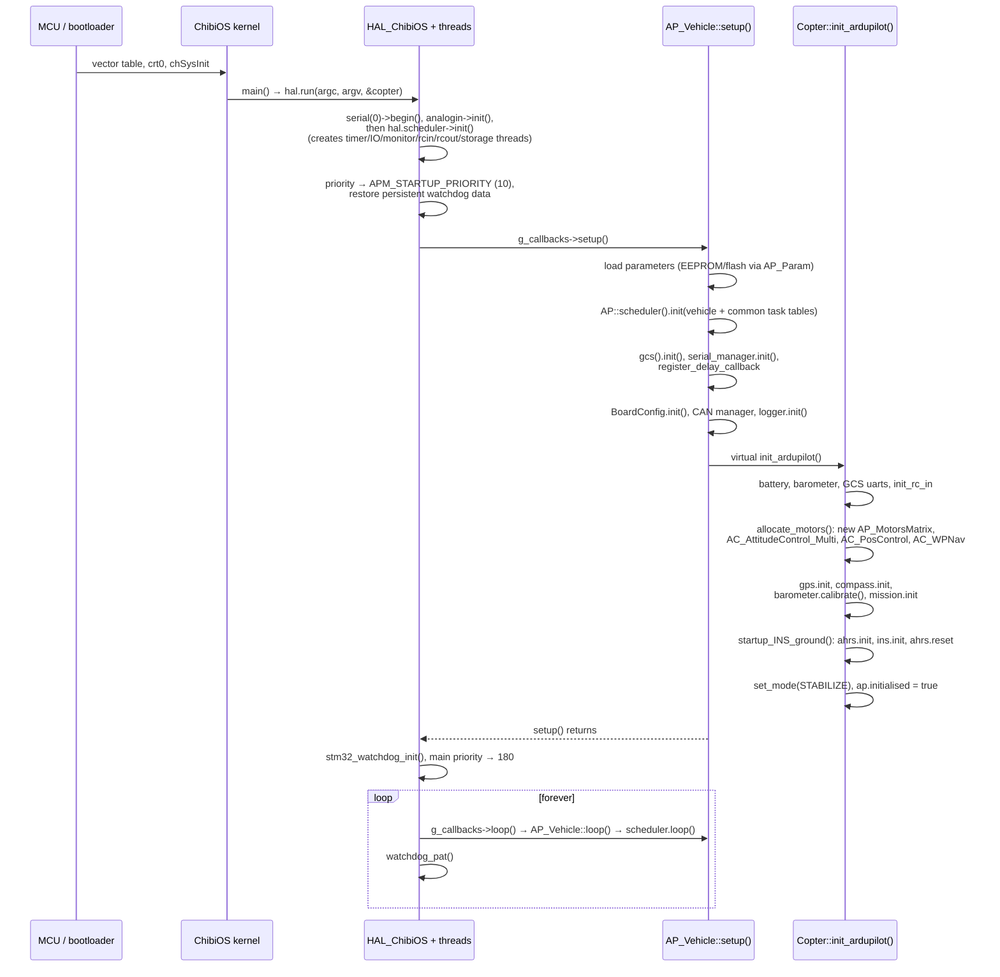
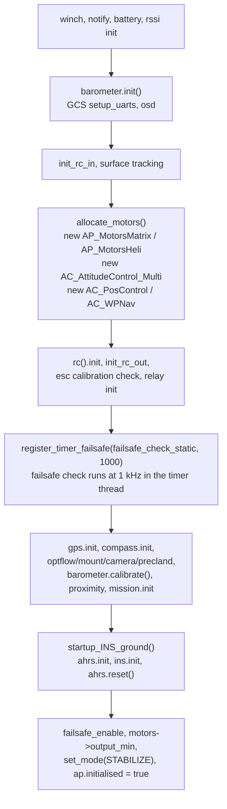

# 03 · Boot & Startup

Power-on to flight-ready: how `main()` gets to `loop()`, what gets initialized in what order, and why the order is the way it is.

**[← Back to index](../README.md)**

---

## The Big Picture

On an STM32 board, startup flows through four "worlds": the **bootloader** (not covered here — it lives in [`Tools/AP_Bootloader/`](https://github.com/ArduPilot/ardupilot/tree/e96bd9053e/Tools/AP_Bootloader)), the **ChibiOS kernel**, the **HAL**, and finally **vehicle code**. The vehicle registers itself as the HAL's `Callbacks` object via one macro, and everything else is ordinary function calls.



## Step by Step (ChibiOS path)

### 1. Entry: `AP_HAL_MAIN_CALLBACKS`

Each vehicle ends with (e.g. [`ArduCopter/Copter.cpp:971`](https://github.com/ArduPilot/ardupilot/blob/e96bd9053e/ArduCopter/Copter.cpp#L971)):

```cpp
Copter copter;            // the global vehicle object
AP_Vehicle& vehicle = copter;
AP_HAL_MAIN_CALLBACKS(&copter);   // defines main()
```

[`AP_HAL_Main.h`](https://github.com/ArduPilot/ardupilot/blob/e96bd9053e/libraries/AP_HAL/AP_HAL_Main.h) expands to `main()` → `hal.run(argc, argv, &copter)`. Nothing else in vehicle code knows about `main`.

### 2. `HAL_ChibiOS::run()` ([`HAL_ChibiOS_Class.cpp:360`](https://github.com/ArduPilot/ardupilot/blob/e96bd9053e/libraries/AP_HAL_ChibiOS/HAL_ChibiOS_Class.cpp#L360))

1. Optional early watchdog init.
2. USB / serial console bring-up, `AP::sitl()->init()` if simulating on hardware.
1. `main_loop()` ([`HAL_ChibiOS_Class.cpp:233-356`](https://github.com/ArduPilot/ardupilot/blob/e96bd9053e/libraries/AP_HAL_ChibiOS/HAL_ChibiOS_Class.cpp#L233-L356)):
   - `chThdSetPriority(APM_MAIN_PRIORITY)` — main becomes a normal RTOS thread;
   - `hal.serial(0)->begin()` (console) and `hal.analogin->init()` — console and ADC come up **before** the threads exist;
   - `hal.scheduler->init()` — **creates the monitor, timer, rcout, rcin, IO and storage threads** ([`Scheduler.cpp:101-159`](https://github.com/ArduPilot/ardupilot/blob/e96bd9053e/libraries/AP_HAL_ChibiOS/Scheduler.cpp#L101-L159)); from here interrupts and other threads are alive;
   - drop to `APM_STARTUP_PRIORITY` (10) and **restore persistent (watchdog-RAM) data** if the last reset was a watchdog reset;
   - `g_callbacks->setup()` — the vehicle starts;
   - `stm32_watchdog_init()` (if `BRD_OPTIONS` watchdog bit enabled) and `set_system_initialized()` (arms the SysTick lockup detector);
   - raise main priority back to 180 and enter `while(true) { g_callbacks->loop(); delay_microseconds(50) unless boosted; watchdog_pat(); }`.

### 3. `AP_Vehicle::setup()` ([`AP_Vehicle.cpp:315`](https://github.com/ArduPilot/ardupilot/blob/e96bd9053e/libraries/AP_Vehicle/AP_Vehicle.cpp#L315))

The `final` shared setup — this is *the* boot sequence for all six vehicles ([`AP_Vehicle.cpp:315-575`](https://github.com/ArduPilot/ardupilot/blob/e96bd9053e/libraries/AP_Vehicle/AP_Vehicle.cpp#L315-L575), abbreviated):

1. `setup_sketch_defaults()` + console init + firmware-version print.
2. `AP_Param::check_var_info()` → `load_parameters()` — read every persisted parameter from storage into its member (EEPROM/flash via `AP_Param`).
3. `AP::scheduler().init(tasks…)` — the scheduler now knows the vehicle's *and* the common task tables; `G_Dt` starts flowing.
4. `set_control_channels()` — wire RC/SERVO functions.
5. `gcs().init()` then `serial_manager.init()` — every `SERIALx_PROTOCOL` device opens.
6. `register_delay_callback(scheduler_delay_callback, 5)` — MAVLink serviced during main-thread `delay()`.
7. `BoardConfig.init()` → CAN manager init → MSP init → `logger.init()` — board options, CAN, dataflash.
8. **`init_ardupilot()`** — the pure-virtual step, i.e. the vehicle's own init.
9. Scripting, airspeed, `AP::srv()`, GyroFFT, notify/statstext, arming init — then the `"ArduPilot Ready"` banner.

### 4. `Copter::init_ardupilot()` ([`ArduCopter/system.cpp:16`](https://github.com/ArduPilot/ardupilot/blob/e96bd9053e/ArduCopter/system.cpp#L16))

Vehicle-specific wiring, in a meaningful order:



Notes worth knowing:

- **Allocations happen once, at boot** (e.g. `allocate_motors()` news the mixer and controllers — one of the few `new`s on ChibiOS targets; they live forever and are never freed).
- `startup_INS_ground()` waits for the first gyro/accel samples and does the initial attitude alignment (level from accelerometers).
- `register_timer_failsafe` puts the vehicle's `failsafe_check()` in the **timer thread at 1 kHz**: if scheduler ticks stall for more than **2 s** it first reduces throttle, then disarms ([`ArduCopter/failsafe.cpp:35-72`](https://github.com/ArduPilot/ardupilot/blob/e96bd9053e/ArduCopter/failsafe.cpp#L35-L72)). This is the first of three watchdog layers (see [04](04-scheduler-realtime-loop.md)).
- Compass is *not* boot-calibrated: `Compass::cal_update` runs as a 100 Hz common scheduler task and finishes any saved calibration in the background. The barometer *is* leveled at boot (`barometer.calibrate()`).
- If the vehicle crashes and reboots, `PersistentData` (saved in backup registers before reset) tells it *why* (watchdog flags, last modes) — reported via statustext and the `WDOG` log message.

## Startup on SITL

Identical flow, different `run()`: `HAL_SITL::run()` ([`HAL_SITL_Class.cpp:228`](https://github.com/ArduPilot/ardupilot/blob/e96bd9053e/libraries/AP_HAL_SITL/HAL_SITL_Class.cpp#L228)) parses args, brings the simulated sensors/gates up, calls `callbacks->setup()`, then `while(true) { callbacks->loop(); Scheduler::_run_io_procs(); }`. Timer procs run inside `delay()` calls in the main thread. The boot order of `AP_Vehicle::setup()` is unchanged — a design invariant.

## What "ready" means

There is no explicit "ready" flag beyond `ap.initialised` (note the British spelling — it's a packed bitfield struct in [`Copter.h`](https://github.com/ArduPilot/ardupilot/blob/e96bd9053e/ArduCopter/Copter.h)). **Arming** (motors live) is a separate, much stricter gate — dozens of `AP_Arming_Copter` checks (GPS, EKF, RC calibration, battery, compass…). Boot readiness just means: parameters loaded, sensors up, task table registered, mode set, and the main loop spinning.

## Common Pitfalls for Contributors

- **Don't add work before `load_parameters()`** — parameters aren't loaded yet, so defaults will mislead you.
- **Don't init serial devices in a constructor** — constructors run *before* `hal.scheduler->init()` created the threads; use `init_ardupilot` or a scheduler task.
- **Anything time-critical must register at the right layer** — 1 kHz+ work belongs in `register_timer_process` (timer thread) or the fast task table (main thread), never in `setup()`.
- **Persistent data and watchdog handling are board-specific** — use `hal.util->PersistentData`, don't poke backup registers directly.

## Navigation

**[← Back to index](../README.md)** · Previous: [02 · HAL & Platforms](02-hal-and-platforms.md) · Next: [04 · Scheduler & Real-Time Loop](04-scheduler-realtime-loop.md)