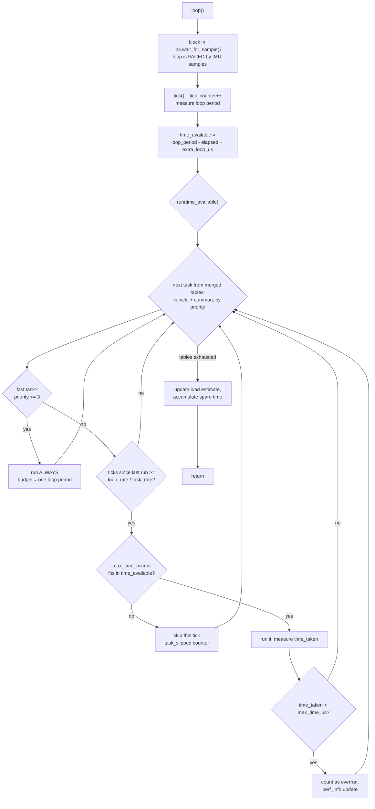
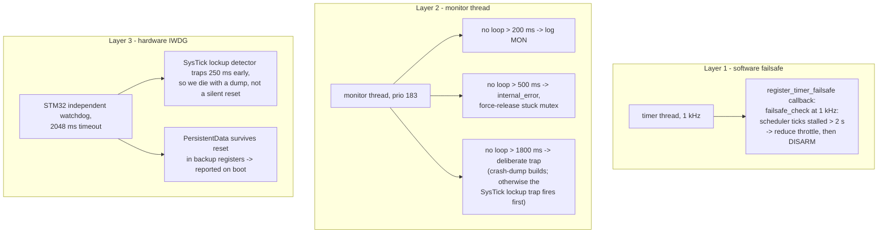

# 04 · Scheduler & Real-Time Loop

How ArduPilot divides one CPU between dozens of periodic jobs without an RTOS task per job: the `AP_Scheduler` cooperative model, task tables, tick arithmetic, load adaptation, and the three-layer watchdog story.

**[← Back to index](../README.md)**

---

## The Model in One Sentence

All flight logic runs in **one main thread**, which loops as fast as its configured rate (set by `SCHED_LOOP_RATE`, clamped to 50–2000 Hz at init; defaults: 400 Hz on Copter/Heli/Sub, 50 Hz on Plane/Rover/Tracker/Blimp) and, on each iteration ("tick"), runs the highest-priority tasks that are due, in priority order, while respecting each task's time budget.

There is no preemption between ArduPilot tasks; the only other threads are HAL-owned (see [02](02-hal-and-platforms.md)). This makes every scheduler decision **deterministic and auditable** — the classic embedded trade: simplicity and predictability over optimal CPU utilization.

## The Task Table

Each vehicle declares a static table; `AP_Vehicle` adds a **common table** shared by all vehicles. The two are merged at runtime.

```cpp
// ArduCopter/Copter.cpp:113 (abbreviated, real entries)
static const AP_Scheduler::Task scheduler_tasks[] = {
    FAST_TASK_CLASS(AP_InertialSensor, &copter.ins, update),
    FAST_TASK(run_rate_controller_main),   // low level rate controllers
    FAST_TASK(motors_output_main),         // send outputs to the motors
    FAST_TASK(read_AHRS),                  // run the EKF state estimator
    FAST_TASK(read_inertia),               // inertial nav
    FAST_TASK(update_flight_mode),         // run the active mode's run()
    SCHED_TASK(rc_loop,                              250,  130,   3),
    SCHED_TASK_CLASS(AP_GPS, &copter.gps,  update,    50,  200,   9),
    SCHED_TASK(throttle_loop,                        50,   75,   6),
    SCHED_TASK(one_hz_loop,                           1,  100,  81),
    SCHED_TASK(ekf_check,                           10,   75,  84),
    SCHED_TASK_CLASS(GCS, (GCS*)&copter._gcs, update_receive, 400, 180, 102),
    ...
};
```

Fields ([`AP_Scheduler.h:88`](https://github.com/ArduPilot/ardupilot/blob/e96bd9053e/libraries/AP_Scheduler/AP_Scheduler.h#L88)):

| Field | Meaning |
|---|---|
| `function` | a `FUNCTOR_BIND`-created callable — bound member functions, no raw pointers |
| `name` | string for logs (`@SYS/tasks.txt`, `PERF` messages) |
| `rate_hz` | desired rate; **0 means "every tick"** |
| `max_time_micros` | advertised worst-case runtime — used as an admission budget |
| `priority` | 0–255; **lower number = higher priority**; `FAST_TASK` macros use the `FAST_TASK_PRI0..2` slots |

Two entry macros: `FAST_TASK`/`FAST_TASK_CLASS` (rate 0, priority `FAST_TASK_PRI0`, budget = one loop period) and `SCHED_TASK`/`SCHED_TASK_CLASS` for everything else.

> **Precision:** `run()` gives *every-tick* treatment to **any task with priority ≤ 3** (`MAX_FAST_TASK_PRIORITIES`, [`AP_Scheduler.cpp:231`](https://github.com/ArduPilot/ardupilot/blob/e96bd9053e/libraries/AP_Scheduler/AP_Scheduler.cpp#L231)) — not just 0–2. So `rc_loop`, table-listed at 250 Hz with priority 3, actually runs on every loop tick (400 Hz default); its `rate_hz` is ignored on the fast path.

### The real Copter fast chain (runs *every* tick, 400 Hz)

`ins.update` → `run_rate_controller_main` → `motors_output_main` → `read_AHRS` (EKF) → `read_inertia` → `check_ekf_reset` → `update_flight_mode` → `update_home_from_EKF` → `update_land_and_crash_detectors` → rangefinder terrain offset → `camera_mount.update_fast`.

That order *is* the attitude control data path: consume gyro sample → close rate PID → output motors → run the estimator → run mode logic. Everything rate-limited comes after in priority order: `throttle_loop` (50 Hz), GPS (50), fence (25), rangefinder (20), baro/compass (10), `one_hz_loop`, `ekf_check` (10), GCS receive/send (400), logging (10–400), `update_logging` (0.1 Hz)… (`rc_loop` nominally lists 250 Hz but, at priority 3, rides the every-tick fast path.)

> **Confused?** The rate controller (400 Hz) is *faster* than the EKF read (400 Hz fast task too on copter via `read_AHRS`) but slower than the *gyro sampling rate* — sensors run on their own bus threads at 1–32 kHz. The scheduler's "loop rate" only paces the **consumer** in the main thread.

## How a Tick Runs: `AP_Scheduler::loop()` and `run()`



Key mechanics ([`AP_Scheduler.cpp:191-346`](https://github.com/ArduPilot/ardupilot/blob/e96bd9053e/libraries/AP_Scheduler/AP_Scheduler.cpp#L191-L346)):

- **Merging**: both tables are pre-sorted by priority; `run()` walks them like a merge sort, vehicle table winning ties.
- **Rate = ticks**: a 50 Hz task with a 400 Hz loop runs every 8th tick (`interval = loop_rate / task_rate`). No timers, no interrupts — just `_tick_counter - _last_run[i]`.
- **Admission control**: before running a normal task, the scheduler checks `task.max_time_micros <= time_available`. Over-budget tasks are deferred, never dropped silently — `task_slipped`/`task_not_achieved` counters feed the perf system.
- **Slip escalation**: if a task misses ≥ 2 intervals it's a "slip"; if the system is so loaded that tasks miss ≥ 4× their interval, `extra_loop_us` grows (up to 5 ms) each loop — effectively **lowering the loop rate** until the system copes. It decays back after 50 clean loops.
- **Fast tasks always run** — they are the attitude control chain, and skipping them would be flight-critical. Their budget is the whole loop period; everything else yields to them.
- **Load estimate**: `load_average() = (loop_us - spare_avg) / loop_us`, forced to 100% if the achieved loop rate falls under 95% of configured. Reported in MAVLink `SYS_STATUS`, the `PERF` log message, and `@SYS/tasks.txt` (per-task min/avg/max, slips, overruns).

## The 1 Hz / 10 Hz "Loops"

Tasks named `one_hz_loop`, `three_hz_loop`, `ten_hz_logging_loop`… are just table entries with those rates — there is no separate loop. Their bodies do housekeeping: aux switch scan, LED updates, buffer trims, statustexts. Failsafe checks are ordinary tasks too: `ekf_check` at 10 Hz, `fence_check` at 25 Hz, battery/compass at 10 Hz — each raising flags that mode/RTL logic consumes immediately.

## The Fast Rate Thread (Copter)

For high-rate setups, Copter can additionally spawn a **rate thread** (`Copter::one_hz_loop` → `thread_create("rate", …, PRIORITY_RCOUT)`, [`Copter.cpp:822`](https://github.com/ArduPilot/ardupilot/blob/e96bd9053e/ArduCopter/Copter.cpp#L822), gated by `AP_INERTIALSENSOR_FAST_SAMPLE_WINDOW_ENABLED` and the `FSTRATE_ENABLE` parameter) so the rate PIDs and motor output close at up to 8 kHz against `AP_InertialSensor`'s fast buffers, decoupled from the main loop's mode/attitude logic ([`ArduCopter/rate_thread.cpp`](https://github.com/ArduPilot/ardupilot/blob/e96bd9053e/ArduCopter/rate_thread.cpp)). On most setups this is off and the fast task chain at loop rate is the whole story.

## Watchdogs — Three Layers



All three exist so that a hang produces (in order): a disarm, a diagnostic log, or a *diagnosable reboot* — never a silent flying brick.

## How to Add a Task (contributor recipe)

```cpp
// 1. Add the task to the vehicle's scheduler_tasks[] with an honest budget:
SCHED_TASK(my_new_check, 10, 100, 90),
// 2. Implement a fast member function:
void Copter::my_new_check() { ... }   // runs at 10 Hz, budget 100 us
```

Rules of thumb: run no faster than needed; keep `max_time_micros` honest (it's an *admission* budget — a lie here steals time from lower-priority tasks); never block; hand long work (SD writes, serial bulk) to `register_io_process`.

## Navigation

**[← Back to index](../README.md)** · Previous: [03 · Boot & Startup](03-boot-and-startup.md) · Next: [05 · Vehicle Layers](05-vehicle-layers.md)