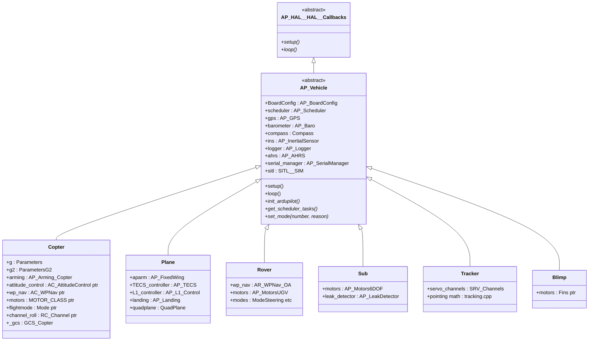
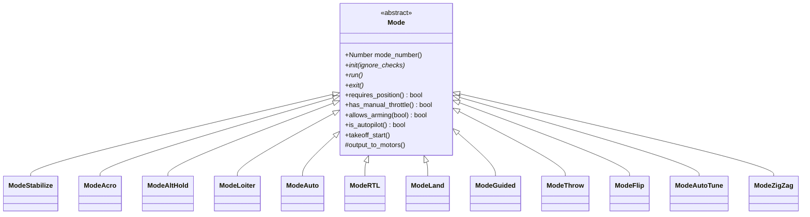
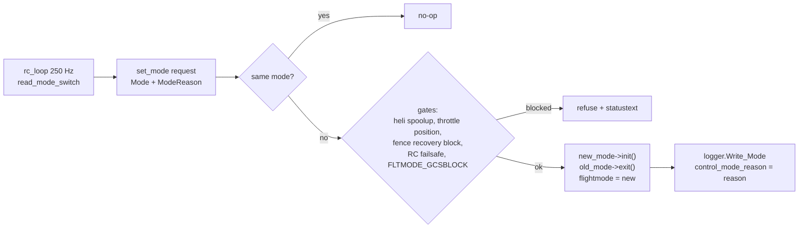

# 05 · Vehicle Layers

How the six vehicle programs are built: the `AP_Vehicle` base class, the `Copter` case study, mode dispatch, arming, failsafes — and how Plane/Rover/Sub/Tracker/Blimp differ.

**[← Back to index](../README.md)**

---

## Shared Base: `AP_Vehicle`

Every vehicle class inherits `libraries/AP_Vehicle/AP_Vehicle.h:98`:

`AP_Vehicle` contributes: all shared sensor/logger/board objects, parameter loading, the **common scheduler task table** (merged with the vehicle's — see [04](04-scheduler-realtime-loop.md)), `ModeReason` codes, mode-change bookkeeping, and GCS-mode blocking flags. Vehicles contribute: the controllers appropriate to their physics, the mode classes, and vehicle-specific arming/failsafe rules.

> **Why "final" setup/loop?** So every vehicle shares one boot and one loop skeleton — a contributor learning `ArduCopter`'s boot already knows `Rover`'s. Vehicle code plugs into `init_ardupilot()` and the task table instead.

## Case Study: `Copter` (`ArduCopter/`)

74 `.cpp` + 18 `.h` files (~30k lines). `Copter.h` declares the object graph:

- **Parameters**: `g` (`Parameters`) + `g2` (`ParametersG2`) — two var_info blocks because one vehicle can exceed 256 top-level parameter keys.
- **RC**: four `RC_Channel*` (`channel_roll/pitch/throttle/yaw`), `RCMapper rcmap`.
- **Estimation**: `AP_AHRS ahrs` (from `AP_Vehicle`), optional `AP_AHRS_View *ahrs_view` (rotated view for exotic frames).
- **Arming**: `AP_Arming_Copter arming` — subclass of the generic `AP_Arming` (`libraries/AP_Arming`) with copter-specific checks.
- **Motors & controllers**: `MOTOR_CLASS *motors` — a compile-time macro selecting `AP_MotorsMulticopter` vs `AP_MotorsHeli` via `FRAME_CONFIG`; heap-allocated in `allocate_motors()` along with `AC_AttitudeControl *attitude_control`, `AC_PosControl`, `AC_WPNav`, `AC_Loiter`, `AC_Circle` (see [07](07-control-pipeline.md)).
- **Modes**: `Mode *flightmode` pointer + one member object per mode (`ModeStabilize stabilize; ModeAcro acro; …`), `ModeGuidedCustom *mode_guided_custom[5]`.
- **GCS**: `GCS_Copter _gcs`.
- **Mission/autonomy**: from `AP_Vehicle` plus `AP_Rally_Copter rally`, `AC_Avoid avoid`, `AP_Avoidance_Copter avoidance_adsb`, `AP_SmartRTL smart_rtl`, `AC_PrecLand precland`, `AP_Camera`, `AP_Mount`, `AP_Terrain`, …
- **State**: a packed bitfield struct `ap` (`arming.is_armed`, `land_complete`, `auto_armed`, failsafe bits…) — serialized as a bitmask for logs; `ModeReason control_mode_reason`.

The entire class declares its GCS, arming, parameters and mode classes as `friend`s — the project's chosen alternative to a getter/setter layer.

### File map

| Files | Contents |
|---|---|
| `Copter.cpp`, `system.cpp` | setup glue, scheduler table, `init_ardupilot`, 1 Hz housekeeping |
| `mode*.cpp` (~30) | one file per flight mode |
| `Attitude.cpp` | attitude control calls from modes |
| `motors.cpp` | mixer setup, safety, interlock |
| `AP_State.cpp` | arm/disarm state, simple mode |
| `AP_Arming_Copter.cpp` | pre-arm/arm check suites |
| `events.cpp`, `failsafe.cpp` | failsafe event dispatch |
| `crash_check.cpp`, `land_detector.cpp` | crash detection; landed detection |
| `Log.cpp`, `GCS_*.cpp` | logging and GCS subclass |

## The Mode System

Every vehicle uses the same pattern — abstract `Mode` base + one subclass per mode + a dispatcher:

ArduCopter's `Mode::Number` enum (`mode.h:77-109`) defines **26 values** — STABILIZE, ACRO, ALT_HOLD, AUTO, GUIDED, LOITER, RTL, CIRCLE, LAND, DRIFT, SPORT, FLIP, AUTOTUNE, POSHOLD, BRAKE, THROW, AVOID_ADSB, GUIDED_NOGPS, SMART_RTL, FLOWHOLD, FOLLOW, ZIGZAG, SYSTEMID, AUTOROTATE, AUTO_RTL, TURTLE — with gaps (8, 10, 12 unused; 30 reserved for "offboard"). AUTO_RTL is a pseudo-mode: AUTO + jump to `DO_LAND_START`.

**Dispatch path** (`mode.cpp:318`):

`ModeReason` (`libraries/AP_Vehicle/ModeReason.h:19-75`, **56 values**) — RC_COMMAND, GCS_COMMAND, RADIO/BATTERY/GCS/EKF/TERRAIN_FAILSAFE, GPS_GLITCH, FENCE_BREACHED, SCRIPTING… — rides along with every mode change, so logs can answer *"why was the vehicle in RTL?"*.

Every fast tick, `update_flight_mode` → `flightmode->run()`. A mode's `run()` reads pilot sticks (or autopilot targets) and commands the controllers — Stabilize feeds pilot angles into `attitude_control`, Loiter feeds position targets into `wp_nav`/`pos_control`, Auto drives `wp_nav` from `AP_Mission` (see [09](09-missions-and-autonomy.md)). The chain into motors is always the same: **mode → `AC_AttitudeControl` input setter → `input_thrust_vector`/`set_throttle_out` → `AP_Motors`** ([07](07-control-pipeline.md)).

## Arming

Generic `libraries/AP_Arming` + vehicle subclasses. `AP_Arming_Copter` (`ArduCopter/AP_Arming_Copter.h`) organizes checks into named suites — `ins_checks`, `gps_checks`, `barometer_checks`, `board_voltage_checks`, `parameter_checks`, `oa_checks`, `mandatory_position_checks`, `gcs_failsafe_check`, `rc_throttle_failsafe_checks`, … The suites are composable: pre-arm runs most of them, arm runs the mandatory subset, and a `REQUIRE` bitmask parameter chooses which are *blocking*. This is how one mechanism serves both "text wall on pre-arm" and "hard safety gate on arming".

## Failsafes

Copter keeps a bitfield of active failsafes (`radio`, `gcs`, `ekf`, `terrain`, `adsb`, `deadreckon`) plus battery, and a **priority table** (`_failsafe_priorities[]`, `Copter.h:640`: TERMINATE > LAND > RTL > SMARTRTL_LAND > SMARTRTL > NONE by default): when several triggers fire at once, the *highest-priority* action wins — actions are `FailsafeAction { NONE, LAND, RTL, SMARTRTL, SMARTRTL_LAND, TERMINATE, AUTO_DO_LAND_START, BRAKE_LAND }` (`Copter.h:598`). Failsafe *detection* lives in scheduled checks; failsafe *reaction* in `do_failsafe_action` (`events.cpp:485`), which funnels into `set_mode` with a `*_FAILSAFE` ModeReason. Crash detection (`crash_check.cpp`) is separate: attitude beyond limits + thrust loss ⇒ disarm.

`land_detector.cpp` decides `land_complete` (throttle low + attitude low + motion low + rangefinder agrees) — the flag that permits auto-disarm and drives landing lights/GCS state.

## The Other Vehicles

### ArduPlane (`ArduPlane/`)

Fixed-wing + **QuadPlane VTOL**. Key differences from Copter:

- Navigation is **scalar cascades**: lateral guidance via `AP_L1_Control` (ground-track controller) and vertical via `AP_TECS` (total-energy speed/altitude controller), feeding **servo functions** (`SRV_Channels`: aileron/elevator/rudder/throttle) rather than a torque mixer.
- A **second control stack for hover**: `QuadPlane` owns an `AP_MotorsMulticopter` and its own attitude controller, switched by `transition_*` state machine — a plane with a whole copter inside.
- Mode classes mirror copter's (`ModeAuto`, `ModeLoiter`, `ModeFBWA`, …) plus Q-modes (`ModeQStabilize`, `ModeQLoiter`, `ModeQLand`, `ModeQRTL`, …).
- Plane-only libs: `AP_Landing` (autoland glide slopes, deepstall, aborts), `AP_Soaring` (thermal hunting), `AP_AdvancedFailsafe_Plane`, `APM_Control` (roll/pitch/yaw/steer PIDs).

### Rover (`Rover/`) — rovers and sailboats

No attitude/altitude — the controlled quantities are **heading and ground speed**: `AR_WPNav` (waypoint navigation with SCurve cornering and pivot turns), `AR_AttitudeControl` (steering PID), `AR_PosControl` (speed→throttle), `AP_MotorsUGV` (steering + throttle SRV functions; skid steering; sail servos for `Sailboat`). Modes: Manual, Hold, Acro, Steering, Loiter, Guided, Auto, RTL, SmartRTL, Follow, Dock… plus `AP_WindVane` for sailboats.

### ArduSub (`ArduSub/`)

Underwater ROV: **6-DoF vectored motors** (`AP_Motors6DOF`), "attitude" without gravity-altitude, **depth** from rangefinder/water-pressure as the vertical reference, `AP_LeakDetector`, lights and grippers as SRV functions, surface mode. 11 modes (Stabilize, Acro, AltHold, PosHold, Guided, Circle, Auto, Manual, Surface, SurfTrak, MotorDetect).

### AntennaTracker (`AntennaTracker/`)

Not a flight vehicle: it **points** pan/tilt servos at another vehicle using its position — `SRV_Channels servo_channels` + tracking geometry (`tracking.cpp`), no attitude control stack. Modes: Manual, Stop, Scan, ServoTest, Auto, Guided, Initialising.

### Blimp (`Blimp/`)

Buoyant indoor airship: thrust-vectoring **fins** instead of rotors (`Fins`/`AR_Motors`), altitude = neutral buoyancy + ballonet, velocity-control modes (velocity, loiter, hold, land, rtl, auto, manual).

## Shared→Vehicle Split — Summary Table

| Concern | Shared library | Vehicle layer adds |
|---|---|---|
| Estimation | `AP_NavEKF3`, `AP_AHRS` | sources config, reset handling |
| Attitude control | `AC_AttitudeControl` | mode→controller calls, arming gates |
| Position nav | `AC_WPNav`/`AC_PosControl`, `AR_WPNav`, `AP_L1_Control`, `AP_TECS` | which nav stack + mode targets |
| Output | `AP_Motors*`, `SRV_Channels` | frame setup, channel layout |
| Missions | `AP_Mission` | `start_command`/`verify_command` switches |
| Comms | `GCS_MAVLink`, `GCS` base | `GCS_Copter`-style subclasses |
| Failsafes | `AP_AdvancedFailsafe` bits, `AP_Arming` | detection tasks + action tables |

## Navigation

**[← Back to index](../README.md)** · Previous: [04 · Scheduler](04-scheduler-realtime-loop.md) · Next: [06 · Sensors & State Estimation](06-sensors-and-state-estimation.md)