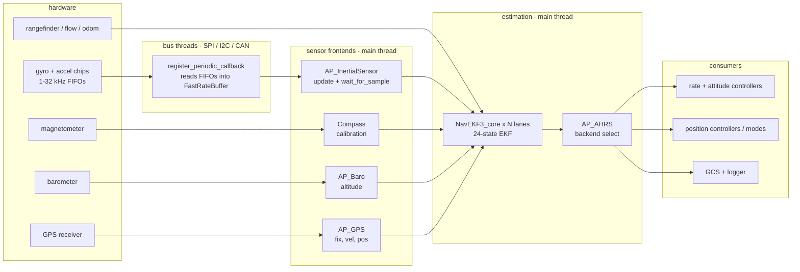
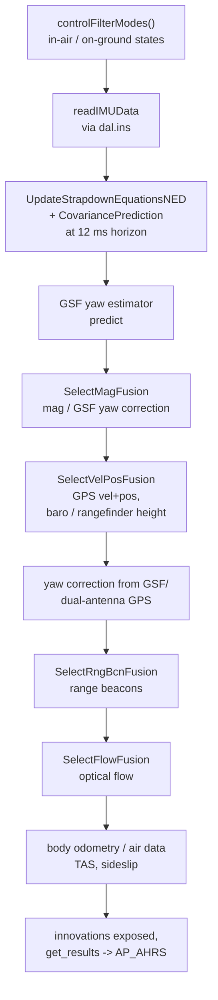

# 06 · Sensors & State Estimation

From raw chip samples to fused attitude/position/velocity: the sensor frontend/backend architecture, the 24-state EKF3, multi-core lanes, `AP_AHRS`, and the AP_DAL replay layer.

**[← Back to index](../README.md)**

---

## The Big Data Path

Two clocks matter: **sampling** (bus threads + frontend `accumulate()` buffers, kHz-range) and **fusion** (main thread, at the 12 ms `EKF_TARGET_DT` horizon inside `UpdateFilter()`). The scheduler's `wait_for_sample()` paces the whole main loop on the first (see [04](04-scheduler-realtime-loop.md)).

## The Frontend/Backend Pattern (with real numbers)

Explained in [01](01-architecture-overview.md); here are the actual driver families in this tree:

| Frontend | Backends | Selection mechanism |
|---|---|---|
| `AP_InertialSensor` | **19 drivers**: Invensense (MPU6k/ICM-4x6x), BMI055/088/160/270, LSM9DS0/9DS1, LSM6DSV, ASM330, ADIS1647x/16607, SCHA63T, L3G4200D, ZeroOne FPGA, … + `SITL`, `ExternalAHRS`, `NONE` | **hwdef probe lists** (`HAL_INS_PROBE_LIST`) + `INS_TYPE`/board detect |
| `Compass` | **23 drivers**: HMC5843, LSM303D, AK8963/09916, LIS3MDL, IST83xx, MAG3110, MMC3416/5xx3, QMC5883, RM3100, IIS2MDC, BMM150/350, … + DroneCAN, MSP, ExternalAHRS, SITL | bus sweeps (`_probe_external_i2c_compasses`), `COMPASS_TYPE` |
| `AP_Baro` | **21 drivers**: BMP085/280/388/581, DPS280, ICM20789, ICP101xx/201xx, KellerLD, LPS2XH, SPL06, FBM320, MS56xx family, DroneCAN, ExternalAHRS, HIL, SITL | probe order + `BARO_PROBE_EXT` |
| `AP_GPS` | **14 protocol drivers** (+ the virtual `Blended`): UBLOX, NMEA, SBP/SBP2, SIRF, ERB, GSOF, NOVA, SBF, DroneCAN, MAV, MSP, ExternalAHRS, SITL; `GPS_Type` enum has 24 values + `SITL=100` | `GPS_TYPE` param + runtime **autobaud/autodetect** state machines |
| `RangeFinder` | **43 drivers** across serial/I2C/PWM/CAN (48 `Type` enum values): LightWare, Benewake, TeraRanger, VL53L0x/1X, Leddar, USD1, NMEA, HC-SR04, … | `RNGFNDx_TYPE` switch |

Backends register themselves via static `probe()`/detect functions; the frontend owns calibration, health tracking, instance arrays and the vehicle-facing API. Instance count is parameter-driven (`INS_COUNT`? — see `AP_InertialSensor::init`).

**IMU extras worth knowing**: `HarmonicNotchFilter` per axis (dynamic notch fed by `AP_GyroFFT` or ESC telemetry, logged as FTN1), `BatchSampler` for high-rate ISBH/ISBD logs, `AP_AccelCal` 6-position calibration, temperature calibration (`AP_InertialSensor_tempcal`), `AuxiliaryBus` for probing sensors *behind* an IMU's SPI aux pins.

## `AP_AHRS` — the Attitude/Position Hub

[`libraries/AP_AHRS/`](https://github.com/ArduPilot/ardupilot/tree/e96bd9053e/libraries/AP_AHRS) is the vehicle-facing API over the estimators:

- **Backends**: `AP_AHRS_NavEKF3` (the default — wraps EKF3), `AP_AHRS_NavEKF2`, `AP_AHRS_DCM` (legacy complementary/DCM fallback), `AP_AHRS_External`, `AP_AHRS_SIM`. Chosen by `AHRS_EKF_TYPE` (declared in `AP_AHRS`'s own var_info, default **3** = EKF3; 0 = DCM, 2 = EKF2).
- `AP_AHRS::update()` runs the configured backend, blends/records results, and publishes: `roll/pitch/yaw`, quaternion, `get_relative_position_NED_origin()`/`_neu()`, velocity NED, origin, wind — plus reset-trackers that watch for attitude/position jumps (EKF lane switches) and warn.
- `AP_AHRS_View` wraps an `AP_AHRS` with a rotation/offset — used by camera mounts/gimbals to see a rotated frame.

**Simple mental model**: sensors → EKF (state estimation) → `AP_AHRS` (consistent view + fallbacks) → everyone else. Vehicles never read GPS or IMUs directly for control.

## EKF3 — the 24-State Filter

[`libraries/AP_NavEKF3/`](https://github.com/ArduPilot/ardupilot/tree/e96bd9053e/libraries/AP_NavEKF3): frontend `NavEKF3` + one `NavEKF3_core` **per IMU enabled in `EK3_IMU_MASK`** (default 3 = two lanes; all lanes run in parallel, allocated in fast RAM via `dal.malloc_type`, and a lane-selection score picks the primary — `EK3_PRIMARY` is forced while disarmed).

### State vector ([`AP_NavEKF3_core.h:576`](https://github.com/ArduPilot/ardupilot/blob/e96bd9053e/libraries/AP_NavEKF3/AP_NavEKF3_core.h#L576))

| Indices | State | Meaning |
|---|---|---|
| 0–3 | quaternion | attitude (body→NED rotation) |
| 4–6 | velocity NED | ground speed |
| 7–9 | position NED | location relative to origin |
| 10–12 | gyro Δθ bias | rate gyro drift |
| 13–15 | accel Δv bias | accelerometer drift |
| 16–18 | earth magnetic field | mag model |
| 19–21 | body magnetic field | mag model |
| 22–23 | wind N/E | wind estimate |

Covariance is a 24×24 `Matrix24`. Prediction math is **generated SymPy code** (Python scripts in [`derivation/`](https://github.com/ArduPilot/ardupilot/tree/e96bd9053e/libraries/AP_NavEKF3/derivation), e.g. [`code_gen.py`](https://github.com/ArduPilot/ardupilot/blob/e96bd9053e/libraries/AP_NavEKF3/derivation/code_gen.py); the generated C++ is a build artifact, not checked in) — humans edit the derivation, not the C++.

### Fusion cycle (`NavEKF3_core::UpdateFilter`, [`AP_NavEKF3_core.cpp:645`](https://github.com/ArduPilot/ardupilot/blob/e96bd9053e/libraries/AP_NavEKF3/AP_NavEKF3_core.cpp#L645))

**Innovation** = measurement minus predicted measurement. Each fusion step computes innovations and their variances and *gates* them (if innovation/variance ratio exceeds a threshold — `EK3_*` gate params — the sample is rejected as an outlier instead of corrupting state). Innovation/variance values are logged (XKF messages) — the primary tuning signal.

**Height and yaw sources** are per-`AP_NavEKF_Source` sets (registered under the EKF3 prefix: `EK3_SRC1_POSXY`, `EK3_SRC1_POSZ`, `EK3_SRC1_YAW`, … `SRC2_*`, `SRC3_*`): PosZ can be baro, GPS, rangefinder, beacon or external nav — with mid-air switching rules (e.g. use rangefinder below `EK3_RNG_USE_HGT`).

**Yaw alignment**: initial tilt from accelerometers, then yaw from magnetic field, GPS ground course, **dual-antenna GPS yaw** (`fuseEulerYaw`), or in-flight **GSF** (Gaussian-sum filter) — `EK3_YAW_METHOD`.

**Multi-core**: each lane runs the full filter on its own IMU; the frontend scores them (innovation levels, fault status, `EK3_PRIMARY`), picks primary/secondary, and can hot-switch lanes — this is what "EKF lane switch" warnings in logs mean. EKF2 (`AP_NavEKF2`) remains selectable for compatibility, but is legacy.

### AP_DAL — deterministic replay

[`libraries/AP_DAL/`](https://github.com/ArduPilot/ardupilot/tree/e96bd9053e/libraries/AP_DAL) is a thin **Data Abstraction Layer**: EKF3 code reads *all* inputs via `dal.ins()`, `dal.gps()`, `dal.baro()`… In normal flight it's a passthrough. With `LOG_REPLAY=1`, every EKF input frame is logged (RFRH/RFRN/RGPH/RISH… messages); [`Tools/Replay`](https://github.com/ArduPilot/ardupilot/tree/e96bd9053e/Tools/Replay) then re-runs the **same** EKF code against the recorded frames with `-p` parameter overrides. This is why EKF3 code uses the unusual `dal.` style — it makes the safety-critical estimator **reproducible from any flight log**.

## GPS Details Worth Knowing

- Drivers are *protocol* engines per vendor; `GPS_TYPE=AUTO` triggers baud-rate cycling and byte-stream detection state machines.
- Multi-instance blending: `AP_GPS_Blended` creates an extra "GPS" whose position/velocity is an accuracy-weighted blend (`GPS_BLEND_MASK`), with hard-switch fallback.
- RTK: `RTCM3_Parser` handles corrections injection; moving-baseline (`MovingBase`) supports dual-antenna heading.
- GPS feeds EKF with antenna offset and lag correction (`readGpsData` via DAL).

## Other Estimation Inputs

| Library | Feeds | Notes |
|---|---|---|
| `AP_OpticalFlow` | EKF3 `SelectFlowFusion` | flow over ground for GPS-less nav |
| `AP_VisualOdom` | EKF external odometry (`VISION_POSITION_DELTA`) | e.g. Intel T265, MAVLink |
| `AP_WheelEncoder` | EKF3 `writeWheelOdom` | rover dead-reckoning |
| `AP_Beacon` | EKF `SelectRngBcnFusion` | Marvelmind/Nooploop ultrasonic beacons |
| `AP_ExternalAHRS` | all sensor frontends as pseudo-sensors | serial AHRS units (VectorNav, SBG, InertialLabs…) — see [11](11-scripting-interfaces-peripherals.md) |
| `AP_Airspeed` | EKF air data (TAS) | plane |

## Navigation Output → Control

The estimator's outputs (`get_results()`) land in `AP_AHRS`: attitude quaternion, NE/D position, NED velocity, wind, gyro/accel biases. Position controllers add their own `read_inertia()`-derived accelerations (see [07](07-control-pipeline.md)). Logging wraps the whole pipeline: IMU/GPS/XKF messages at high rates, all gated by `LOG_BITMASK`.

## Navigation

**[← Back to index](../README.md)** · Previous: [05 · Vehicle Layers](05-vehicle-layers.md) · Next: [07 · Flight Control Pipeline](07-control-pipeline.md)