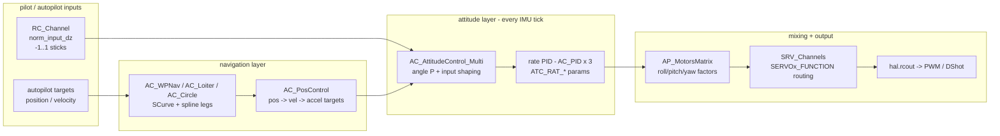
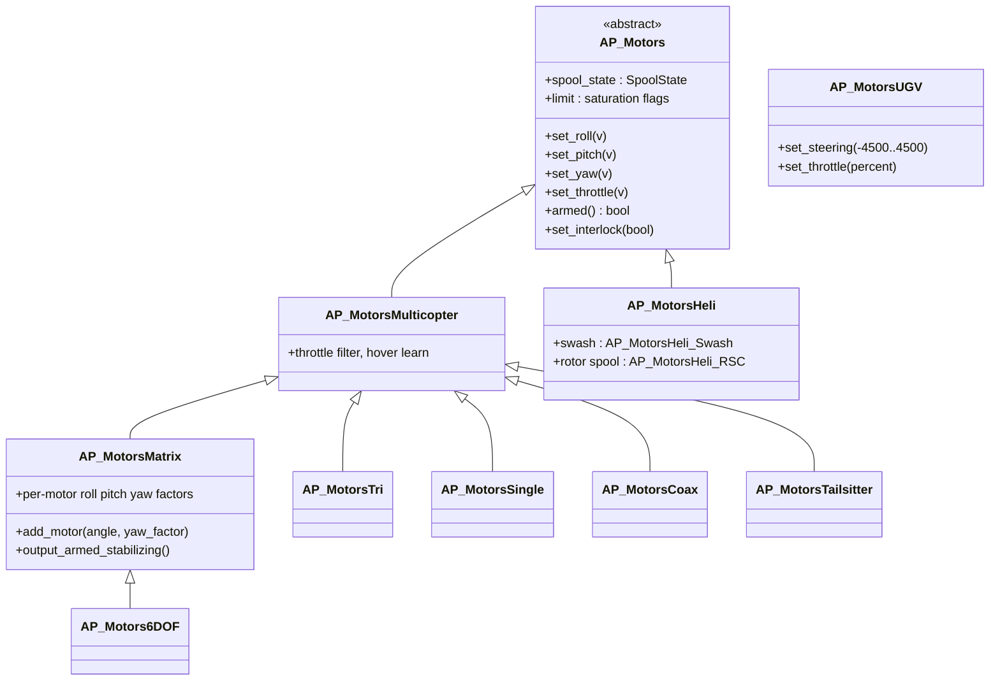
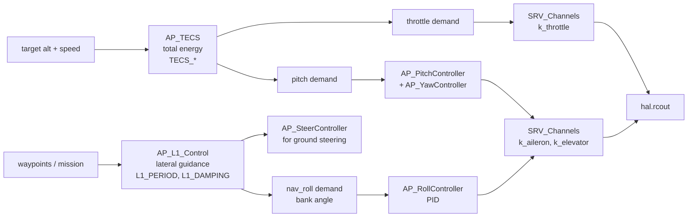
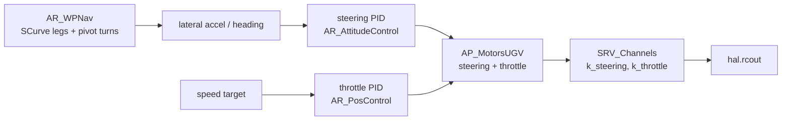

# 07 · Flight Control Pipeline

How stick movements become motor and servo pulses: the multicopter cascade (attitude → rate → mixer), the fixed-wing scalar controllers (L1 + TECS), the rover stack, and the shared output plumbing (`SRV_Channels`).

**[← Back to index](../README.md)**

---

## The Multicopter Chain (Copter/Sub/Blimp/QuadPlane)



### 1. `AC_AttitudeControl` — the attitude cascade

[`libraries/AC_AttitudeControl/`](https://github.com/ArduPilot/ardupilot/tree/e96bd9053e/libraries/AC_AttitudeControl) provides the base class + vehicle variants:

| Class | For | Rate PID flavor |
|---|---|---|
| `AC_AttitudeControl_Multi` | multicopters (incl. Sub/Blimp/QuadPlane) | `AC_PID` |
| `AC_AttitudeControl_Heli` | helicopters (swashplate, virtual flybar) | `AC_HELI_PID` |
| `AC_AttitudeControl_Sub` | Sub 6-DoF | `AC_PID` |
| `AC_AttitudeControl_Multi_6DoF` | vectored 6-DoF | `AC_PID` |
| `AC_AttitudeControl_TS` | tailsitters | `AC_PID` |

Every mode enters via an **input setter** — `input_euler_angle_roll_pitch_euler_rate_yaw_rad()` (angle mode), `input_rate_bf_roll_pitch_yaw_*` (acro), `input_thrust_vector_heading_rad()` (pos-control tilt) — which all funnel into `attitude_controller_run_quat()`:

1. compute the attitude error quaternion (`thrust_vector_rotation_angles`);
2. apply **angle P** controllers (`AC_P _p_angle_{roll,pitch,yaw}`, sqrt-controller shaped, accel-limited by `ATC_RATE_*_MAX`) → body-rate target (`update_ang_vel_target_from_att_error`);
3. `AC_CommandModel` input shaping (`ATC_INPUT_TC` time constant) smooths the target;
4. `rate_controller_run()` — per IMU sample, the **rate PID** (`AC_PID::update_all(target, measurement, dt, limit, …)`) closes the loop against `ahrs.get_gyro_latest()` (or `rate_controller_run_dt(gyro, dt)` with an explicit gyro/dt) and writes normalized −1..1 commands to `motors->set_roll/pitch/yaw(+_ff)`.

Vertical: `set_throttle_out()` passes 0..1 throttle with motor headroom for attitude control (`ATC_THR_MIX_MIN/MAN/MAX` — how much torque authority to reserve vs climb). Logging: RATE, ANG, ATSC messages.

### 2. `AC_PosControl` — position cascade

`AC_PosControl` (since this master-era tree lives in [`AC_AttitudeControl/`](https://github.com/ArduPilot/ardupilot/tree/e96bd9053e/libraries/AC_AttitudeControl)) splits cleanly:

- **Input shaping** (jerk-limited kinematic targets): `input_pos_NED_m`, `input_vel_accel_*`, `D_set_pos_target_from_climb_rate_ms` — *what we want the vehicle to track*, generated smooth.
- **Correction** (the PID cascade): position error → `AC_P_2D` (velocity correction, sqrt-controller) → velocity error → `AC_PID_2D` → acceleration → `accel_NE_mss_to_lean_angles_rad()` → **lean angles**, handed to `AC_AttitudeControl::input_thrust_vector_heading*`. Vertical: `AC_P_1D` → `AC_PID_Basic` (velocity) → `AC_PID` (accel → throttle).

Parameters are `PSC_*` (angle max, jerk, speeds, accelerations), logged as PSCN/PSCE/PSCD….

### 3. `AC_WPNav` — waypoint trajectories

Not a PID — a **trajectory generator** feeding `AC_PosControl`:

- legs are **S-curves** (jerk/snap-limited, `SCurve` class) for waypoints, `SplineCurve` for MAV_CMD spline waypoints, arcs for `set_circle_destination`;
- `set_wp_destination_next_*` blends corners between legs;
- `update_wpnav()` advances the target along track (`WP_RADIUS_M` reach check, slowdown zones, pause/resume; speeds/accel via `WP_SPD`/`WP_ACC`/`WP_ACC_CNR`);
- `AC_WPNav_OA` subclasses it so **object-avoidance-adjusted destinations** slot transparently underneath (see [09](09-missions-and-autonomy.md));
- `AC_Loiter` (position hold with wind braking, `LOIT_*` params) and `AC_Circle` (orbits, `CIRCLE_*` params) are siblings targeting the same `AC_PosControl`.

### 4. `AP_Motors` — the mixers

[`libraries/AP_Motors/`](https://github.com/ArduPilot/ardupilot/tree/e96bd9053e/libraries/AP_Motors):



- `AP_MotorsMatrix::output_armed_stabilizing()` is the classic multirotor mixer: per motor `thrust = throttle·factor ± roll·r ± pitch·p ± yaw·y`, with saturation scaling, motor-failure detection (`check_for_failed_motor`), battery-voltage thrust linearization (`AP_Motors_Thrust_Linearization`), and a **spool state machine** (`SpoolState`: SHUT_DOWN → GROUND_IDLE → SPOOLING_UP → THROTTLE_UNLIMITED → SPOOLING_DOWN) that governs helicopter rotor spin-up and ESC arming behavior.
- `AP_MotorsHeli` adds the swashplate mixer (`AP_MotorsHeli_Swash`: swash types H1, H3, H3-120, H3-140, H4-90, H4-45) and the rotor-speed controller (`AP_MotorsHeli_RSC`).
- Frames are *data*: `MOT_FRAME_CLASS`/`TYPE` parameters select motor layouts (quad X, hexa, octa coax, Y6, …), and `AP_MotorsMatrix_Scripting_Dynamic` can even build frames from **Lua** at runtime.

### 5. `SRV_Channels` — function-routed output

The mixer never "owns" channels. It calls:

```cpp
SRV_Channels::set_output_scaled(SRV_Channel::k_motor1, 0…1000);
```

and every output channel mapped by its **`SERVOx_FUNCTION`** parameter to that function gets the value, scaled by `SERVOx_MIN/MAX/TRIM`, reversed (`SERVOx_REVERSED`), then written via `hal.rcout->write()`. The `Function` enum has **~175 `k_*` entries** — aileron, elevator, rudder, throttle, ground steering, mount pan/tilt, gimbal, lights, gripper, parachute, winch, sails, heater, scripting, … (DShot/PWM protocol selection is board-global via `MOT_PWM_TYPE`, not per-channel in this tree.)

This is the **universal join point**: whichever vehicle, whichever controller, output ends as `set_output_*(function, value)`. It's why a plane and a copter share one output stack.

### RC input side

[`libraries/RC_Channel/`](https://github.com/ArduPilot/ardupilot/tree/e96bd9053e/libraries/RC_Channel): each `RC_Channel` owns `RCx_MIN/MAX/TRIM`, `RCx_DZ` deadzone, `RCx_REVERSED`, and `RCx_OPTION` (aux switch function — **~180 `AUX_FUNC` options**: mode switches, RTL, arm/disarm, camera trigger, winch, …). `RC_Channels::read_aux_all()` (a 10 Hz scheduler task) polls option switches; `read_mode_switch()` reads the flight-mode channel. Input flows: `AP_RCProtocol` (see [08](08-gcs-and-communications.md)) decodes frames into the HAL `RCInput`, and `RC_Channels::read_input()` pulls channel PWM from `hal.rcin` each pass.

## Fixed-Wing Chain (Plane / QuadPlane hover)

Plane replaces the vector cascade with two **scalar** controllers plus its own attitude PIDs ([`libraries/APM_Control/`](https://github.com/ArduPilot/ardupilot/tree/e96bd9053e/libraries/APM_Control): `AP_RollController`/`AP_PitchController` derive from the new `AP_FW_Controller` base, alongside `AP_YawController` and `AP_SteerController`):



- **L1** (`AP_L1_Control`) computes demanded lateral acceleration from cross-track error with period/damping dynamics (`K_L1 = 4·damping²`, `_L1_dist = 1/π · damping · period · groundSpeed`; defaults `L1_PERIOD` 17, `L1_DAMPING` 0.75) — also reused by Rover and sailboats via the `AP_Navigation` interface.
- **TECS** (`AP_TECS`) balances **total energy**: throttle controls the energy sum, pitch trades kinetic↔potential energy; outputs `get_throttle_demand()` (%) and `get_pitch_demand()` with underspeed protections; `TECS_*` parameters (`TECS_CLMB_MAX`, `TECS_SINK_MIN`, `TECS_TIME_CONST`, …).
- **Autoland/deepstall/abort logic**: `AP_Landing` (see [09](09-missions-and-autonomy.md)).
- **QuadPlane**: the copter stack (`AP_MotorsMulticopter` + `AC_AttitudeControl_Multi` via `AC_AttitudeControl_Multi`'s parent) rides *alongside*, engaged by the transition state machine — plane controls surfaces for cruise, copter stack for hover; **TECS keeps working in cruise while `AC_PosControl` holds altitude in hover**.

## Rover Chain (heading + speed)



`AR_WPNav` reuses the SCurve cornering machinery for ground kinematics; sailboats (`Sailboat` subclasses) substitute wind-vane tacking (`AP_WindVane`) and sail servos.

## Tuning Machinery

| Tool | Library | How |
|---|---|---|
| **AutoTune** | `AC_AutoTune` (+`AC_AutoTune_Multi/Heli`, `AC_AutoTune_FreqResp`) | twitch each axis, measure response, propose P/I/D, save if better |
| **Quicktune** | `AP_Quicktune` | lightweight per-axis staged tuning from a switch/GCS |
| **Tuning knob** | `AP_Tuning` | map an RC knob to a parameter set live |

All write the same `ATC_*`/`PSC_*` parameters via `set_and_save` — one tuning surface, several front doors.

## Parameter Namespaces (cheat sheet)

| Prefix | Subsystem |
|---|---|
| `ATC_` | attitude + rate control |
| `PSC_`, `WP_`, `LOIT_`, `CIRCLE_` | position/waypoint/loiter/circle |
| `MOT_` | motor mixer + spool |
| `SERVOx_` | per-output servo functions/ranges |
| `RCx_` | RC input scaling/options |
| `TECS_`, `L1_` | fixed-wing energy + lateral nav |
| `AUTOTUNE_` | autotune |

## Navigation

**[← Back to index](../README.md)** · Previous: [06 · Sensors](06-sensors-and-state-estimation.md) · Next: [08 · GCS & Communications](08-gcs-and-communications.md)