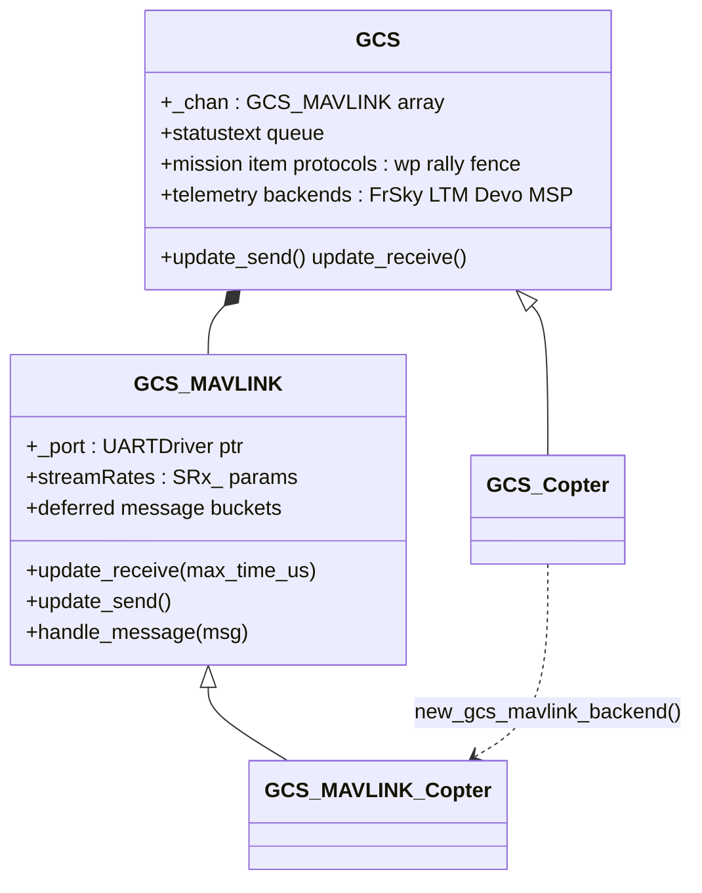
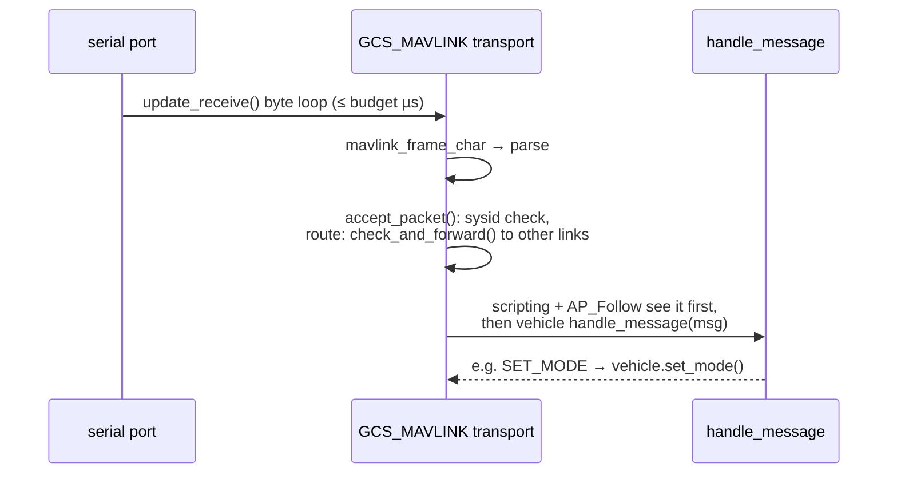

# 08 · GCS & Communications

The MAVLink ground-control stack, stream scheduling, packet routing, the serial manager, non-MAVLink telemetry, RC receiver protocols, and DroneCAN.

**[← Back to index](../README.md)**

---

## Ground Control = MAVLink

Everything a ground station (Mission Planner, QGC, MAVProxy, or ArduPilot's own tools) does with the vehicle goes through [`libraries/GCS_MAVLink/`](https://github.com/ArduPilot/ardupilot/tree/e96bd9053e/libraries/GCS_MAVLink). MAVLink C headers are **generated inside the build** (`mavgen` waf feature) from [`modules/mavlink/message_definitions/v1.0/all.xml`](https://github.com/ArduPilot/mavlink/blob/e03dad40efb3a4009ad6d78de5e55997139ac2f3/message_definitions/v1.0/all.xml) into `libraries/GCS_MAVLink/include/mavlink/v2.0/` — treat that directory as build output, not source.

### The two-layer GCS design

- **`GCS_MAVLINK`** ([`GCS.h:174`](https://github.com/ArduPilot/ardupilot/blob/e96bd9053e/libraries/GCS_MAVLink/GCS.h#L174)) is the *transport*: parse bytes, enforce stream rates, defer sends, route packets. [`GCS_Common.cpp`](https://github.com/ArduPilot/ardupilot/blob/e96bd9053e/libraries/GCS_MAVLink/GCS_Common.cpp) (~7,800 lines) is its shared implementation — the big switchboards `handle_command_long`/`handle_command_int` (arm, home, ROI, mount, calibrations, storage…), the mission-item protocols, FTP-over-MAVLink, signing, serial passthrough.
- **`GCS`** ([`GCS.h:1142`](https://github.com/ArduPilot/ardupilot/blob/e96bd9053e/libraries/GCS_MAVLink/GCS.h#L1142)) is the *vehicle-facing singleton* (`gcs()`): statustext fan-out, `send_message(AP_Message)` broadcast API, and the array of `GCS_MAVLINK` transports.
- Each vehicle pairs a `GCS_<Vehicle>` with a `GCS_MAVLINK_<Vehicle>` and overrides only the vehicle-specific virtuals (`custom_mode` encoding, `send_attitude`, a few handlers). AP_Periph uses the same pair (`GCS_Periph`).

### Receive path

`update_receive`/`update_send` are **scheduler tasks** on every vehicle (Copter: 400 Hz each, ~180/550 µs budgets; each `GCS_MAVLINK::update_receive` pass stops after ~1 ms of parsing per link — [`GCS_Common.cpp:1995`](https://github.com/ArduPilot/ardupilot/blob/e96bd9053e/libraries/GCS_MAVLink/GCS_Common.cpp#L1995)). Sending is additionally gated by `min_loop_time_remaining_for_message_send_us()` (200 µs) so telemetry never starves the flight loop.

### Send path & stream rates

Outbound messages are **deferred into rate buckets**: each `ap_message` id gets an interval (from `SRx_*` stream-rate parameters per channel, or from `MAV_CMD_SET_MESSAGE_INTERVAL`, or from on-board config files). `update_send()` spends at most 5 ms per link per pass, walking buckets, round-robining links so one busy telemetry radio can't starve the USB one, with backoff (`stream_slowdown_ms`) when a link can't keep up.

`STREAM_*` enum (RAW_SENSORS, EXTENDED_STATUS, RC_CHANNELS, POSITION, EXTRA1/2/3, PARAMS, ADSB…) + per-message mapping (`all_stream_entries[]`) is how `SRx_*` parameters fan out onto individual messages.

### Routing

`MAVLink_routing` ([`MAVLink_routing.h`](https://github.com/ArduPilot/ardupilot/blob/e96bd9053e/libraries/GCS_MAVLink/MAVLink_routing.h)) learns sysid/component/type per link from heartbeats (20-entry table) and **forwards packets between links** — companion computers on `SERIALx`, `check_and_forward()`, `send_to_components()`. `MAV_OPTIONS` bits (`NO_FORWARD`, `UNICAST`, …) gate it. This is how "MAVLink2 via onboard computer" comms transparently works: telemetry in, MAVLink out, both directions.

## `AP_SerialManager` — who gets which UART

Every serial port's role is parameter-driven (`SERIALx_PROTOCOL` / `SERIALx_BAUD`). `AP_SerialManager::init()` opens all ports; libraries claim them with `find_serial(protocol, instance)`.

Selected `SerialProtocol` values (from [`AP_SerialManager.h:102`](https://github.com/ArduPilot/ardupilot/blob/e96bd9053e/libraries/AP_SerialManager/AP_SerialManager.h#L102)): MAVLink 1/2, `FrSky_D`/`SPort`(+passthrough), `GPS`, `AlexMos`, `Gimbal`, `Rangefinder`, `Lidar360`, `Aerotenna_USD1`, `Beacon`, `Volz`, `Sbus1`, `ESCTelemetry`, `Devo_Telem`, `OpticalFlow`, `Robotis`, `NMEAOutput`, `WindVane`, `SLCAN`, `RCIN`, `EFI`, `LTM`, `RunCam`, `Hott`, `Scripting`, `CRSF`, `Generator`, `Winch`, `MSP`, `DJI_FPV`, `AirSpeed`, `ADSB`, `AHRS`, `SmartAudio`, `FETtecOneWire`, `Torqeedo`, `AIS`, `CoDevESC`, `MSP_DisplayPort`, `MAVLinkHL`, `Tramp`, `DDS_XRCE`, `IMUOUT`, `PPP`, `IBus_Telem`, `IOMCU`.

Note the pattern: **protocols here are "who talks on this port", not only "telemetry vs data"** — GPS, scripting, RC-in-over-serial, CAN-slave are all protocol assignments.

## Non-MAVLink Telemetry

Each is a small class tree registered from `GCS`. FrSky backends run their **own thread** (`thread_create("FrSky")`, [`AP_Frsky_Backend.cpp:21`](https://github.com/ArduPilot/ardupilot/blob/e96bd9053e/libraries/AP_Frsky_Telem/AP_Frsky_Backend.cpp#L21)); most others tick from scheduler tasks or IO callbacks (`register_io_process`):

| Library | What | Shape |
|---|---|---|
| `AP_Frsky_Telem` | FrSky D / S.Port / S.Port-passthrough; **MAVlite** params over S.Port | frontend + `AP_Frsky_Backend` family |
| `AP_LTM_Telem` | LTM packets | flat class |
| `AP_Devo_Telem` | Walkera Devo | flat |
| `AP_Hott_Telem` | Graupner HOTT bidirectional poll | flat |
| `AP_IBus_Telem` | FlySky iBUS sensors | flat |
| `AP_MSP` | MSP/DisplayPort telemetry (Betaflight-style OSDs, DJI FPV) | frontend + `AP_MSP_Telem_Backend` family |

## RC Receiver Protocols — `AP_RCProtocol`

Protocol decoding is deliberately **out of the HAL**: [`libraries/AP_RCProtocol/`](https://github.com/ArduPilot/ardupilot/tree/e96bd9053e/libraries/AP_RCProtocol) owns it. `AP_HAL_*::RCInput` just delivers pulse widths/bytes; `AP::RC()` (`AP_RCProtocol`) autodetects and decodes:

| Protocol (`rcprotocol_t`) | Transport |
|---|---|
| `PPMSUM` | pulse stream |
| `SBUS` / `SBUS_NI` / `FASTSBUS` | 100 kbaud inverted serial |
| `DSM`, `SUMD`, `SRXL`, `SRXL2`, `GHST` | serial byte stream |
| `CRSF` (incl. ExpressLRS) | serial byte stream |
| `FPORT` / `FPORT2` | serial, bidirectional with S.Port telemetry |
| `ST24`, `IOMCU`, `EMLID_RCIO`, `MAVLINK_RADIO`, `UDP`/`FDM` (SITL), `JOYSTICK_SFML` | special |

The frontend feeds pulses (PPM) or bytes (serial) into all undetected backends until one latches a valid frame (`_detected_protocol`); `new_input()`/`read()` publish 14+ channels + RSSI into `RC_Channels`. ELRS is CRSF — there is no separate "ELRS" enum.

## CAN: DroneCAN & friends

- `AP_CANManager` owns `AP_CANDriver`s selected by `CAN_Px_DRIVER`: **DroneCAN** (`AP_DroneCAN` on **libcanard**, [`modules/DroneCAN`](https://github.com/ArduPilot/ardupilot/tree/e96bd9053e/modules/DroneCAN)), **PiccoloCAN**, **KDECAN**, plus SLCAN (CAN-over-serial), and MAVLink tunneled CAN (`AP_MAVLinkCAN`, `CAN_FORWARD`).
- DroneCAN code is **generated** (`dronecangen` from DSDL) — again, build output.
- `AP_DroneCAN_DNA_Server` handles dynamic node-ID allocation; per-sensor clients live in each sensor library (`AP_Baro`, `Compass`, `AP_GPS` DroneCAN backends, `AP_Generator`, `AP_EFI`, …).
- **[`Tools/AP_Periph/`](https://github.com/ArduPilot/ardupilot/tree/e96bd9053e/Tools/AP_Periph)** is a whole separate firmware ("AP_Periph") that turns a cheap board into a DroneCAN peripheral: GPS/baro/compass/mag/battery/rangefinder… broadcast over CAN, MAVLink-capable, updatable over CAN. See [11](11-scripting-interfaces-peripherals.md).

## Scripting & companion hooks

- `AP_Scripting::handle_message()` — the Lua VM gets **every MAVLink frame** (see [11](11-scripting-interfaces-peripherals.md)).
- `AP_Follow::handle_msg()` — ingests target position/velocity (`GLOBAL_POSITION_INT` / `FOLLOW_TARGET`) from a GCS sysid.
- `AP_ExternalControl` — MAVLink-driven GUIDED-style external control (companion computers, ROS).

## Navigation

**[← Back to index](../README.md)** · Previous: [07 · Control Pipeline](07-control-pipeline.md) · Next: [09 · Missions & Autonomy](09-missions-and-autonomy.md)