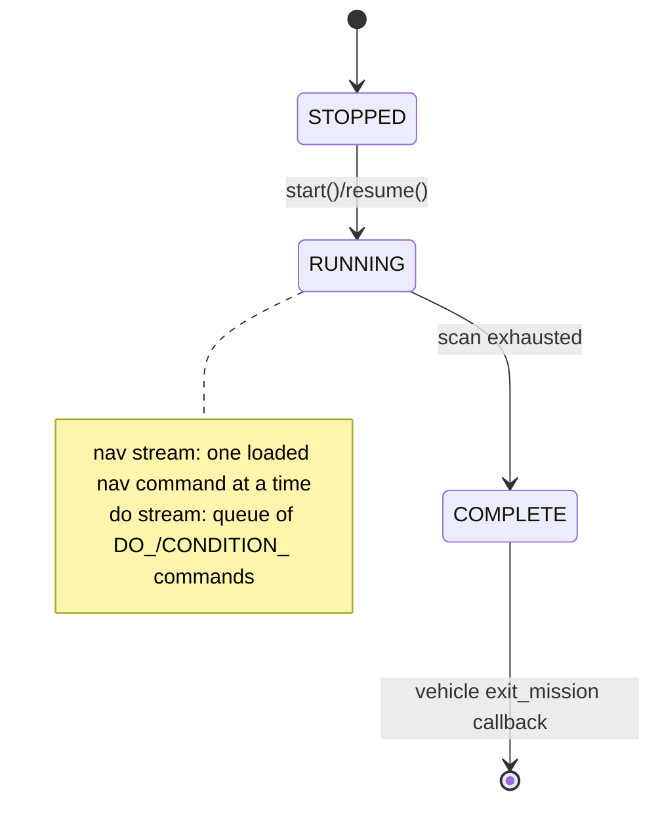
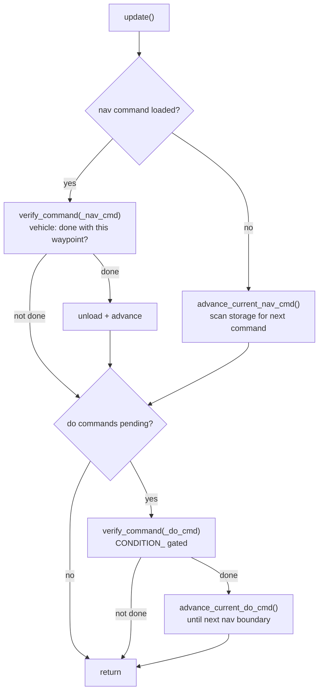
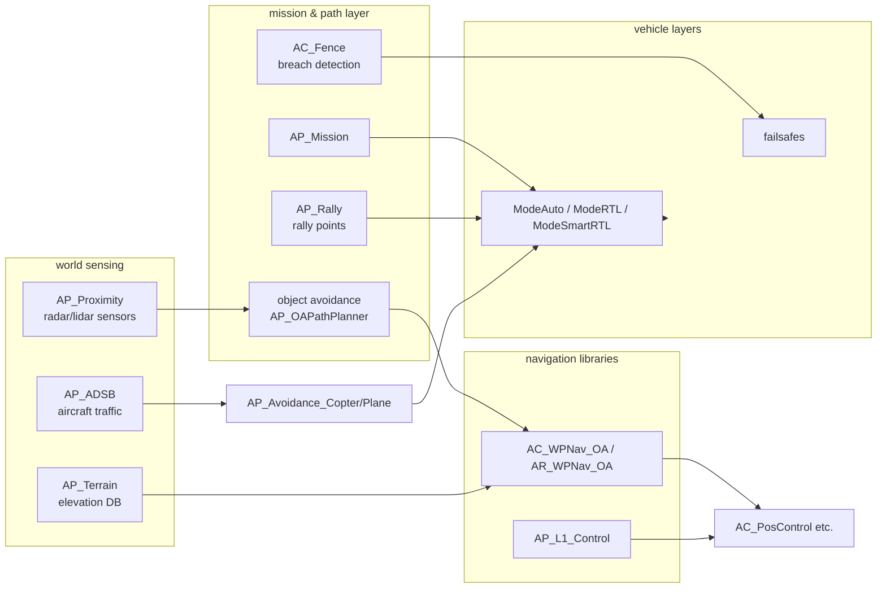

# 09 · Missions & Autonomy

The `AP_Mission` command engine and state machine, the dual nav/do command streams, jump handling, plus the autonomy satellites: rally, fences, object avoidance, terrain, SmartRTL, precision landing, and the payload/payload-adjacent libraries.

**[← Back to index](../README.md)**

---

## AP_Mission — the Command Engine

[`libraries/AP_Mission/`](https://github.com/ArduPilot/ardupilot/tree/e96bd9053e/libraries/AP_Mission) ([`AP_Mission.h`](https://github.com/ArduPilot/ardupilot/blob/e96bd9053e/libraries/AP_Mission/AP_Mission.h), [`AP_Mission.cpp`](https://github.com/ArduPilot/ardupilot/blob/e96bd9053e/libraries/AP_Mission/AP_Mission.cpp) ~3,300 lines) is a **vehicle-agnostic interpreter** for a list of commands (a "mission") stored in persistent storage. It does not know how to fly — it knows how to *sequence*.

### Vehicle coupling — three functors

```cpp
AP_Mission mission{
    FUNCTOR_BIND_MEMBER(&ModeAuto::start_command,  bool, const AP_Mission::Mission_Command&),
    FUNCTOR_BIND_MEMBER(&ModeAuto::verify_command, bool, const AP_Mission::Mission_Command&),
    FUNCTOR_BIND_MEMBER(&ModeAuto::exit_mission,   void)};
```

`start_command` = begin action; `verify_command` = poll "done yet?"; `exit_mission` = mission over → each vehicle translates generic commands into its own nav stack. Plane's equivalent lives in [`ArduPlane/commands_logic.cpp`](https://github.com/ArduPilot/ardupilot/blob/e96bd9053e/ArduPlane/commands_logic.cpp), Rover's in [`Rover/mode_auto.cpp`](https://github.com/ArduPilot/ardupilot/blob/e96bd9053e/Rover/mode_auto.cpp).

### The `Mission_Command`

```cpp
struct Mission_Command {
    uint16_t index;      // position in the list (0 = home)
    uint16_t id;        // MAV_CMD
    uint16_t p1;        // param 1 (generic)
    union Content {...}; // Location (nav) OR one of ~25 packed payload structs
};
```

**Layout in storage** (`StorageManager::StorageMission`): a 4-byte version word (`AP_MISSION_EEPROM_VERSION` = `0x65AE`; a mismatch wipes the area — `check_eeprom_version`, [`AP_Mission.cpp:2521`](https://github.com/ArduPilot/ardupilot/blob/e96bd9053e/libraries/AP_Mission/AP_Mission.cpp#L2521)), then fixed-size **15-byte records** (`AP_MISSION_EEPROM_COMMAND_SIZE`). Max commands = `(area_size - 4) / 15` ([`AP_Mission.cpp:82`](https://github.com/ArduPilot/ardupilot/blob/e96bd9053e/libraries/AP_Mission/AP_Mission.cpp#L82)); index **0 is always home**. If `BRD_SD_MISSION` is set, the mission overflows to an SD file (`APM/mission.stg`) transparently.

### The grammar (~70 MAV_CMDs)

| Category | Commands (abbreviated) |
|---|---|
| **NAV** | `WAYPOINT`, `SPLINE_WAYPOINT`, `ARC_WAYPOINT`, `LOITER_UNLIM/TURNS/TIME/TO_ALT`, `TAKEOFF`, `TAKEOFF_LOCAL`, `LAND`, `LAND_LOCAL`, `VTOL_TAKEOFF/LAND`, `RETURN_TO_LAUNCH`, `CONTINUE_AND_CHANGE_ALT`, `DELAY`, `NAV_DELAY`, `PAYLOAD_PLACE`, `SCRIPT_TIME`, `ATTITUDE_TIME`, `ALTITUDE_WAIT`, `SET_YAW_SPEED` |
| **CONDITION_** | `DELAY`, `DISTANCE`, `YAW` — pause the *do*-stream until true |
| **DO_** | `JUMP`, `JUMP_TAG`, `SET_HOME`, `CHANGE_SPEED`, `SET_SERVO/RELAY`, `REPEAT_SERVO/RELAY`, `DIGICAM_*`, `SET_CAM_TRIGG_DIST`, `SET_ROI[_LOCATION/_NONE/_WPNEXT_OFFSET]`, `MOUNT_CONTROL`, `PARACHUTE`, `GRIPPER`, `SPRAYER`, `ENGINE_CONTROL`, `VTOL_TRANSITION`, `INVERTED_FLIGHT`, `GO_AROUND`, `LAND_START`, `FENCE_ENABLE`, `AUX_FUNCTION`, `GIMBAL_MANAGER_*`, `SEND_SCRIPT_MESSAGE`, `WINCH`, `SET_RESUME_REPEAT_DIST`, `IMAGE_START/STOP_CAPTURE`, `SET_CAMERA_ZOOM/FOCUS/SOURCE`, `VIDEO_START/STOP_CAPTURE`, `DO_GUIDED_LIMITS`… |

Most **DO_** commands are handled *generically* inside [`AP_Mission_Commands.cpp`](https://github.com/ArduPilot/ardupilot/blob/e96bd9053e/libraries/AP_Mission/AP_Mission_Commands.cpp) (gripper, servo events, camera, parachute, ROI…): they never reach vehicle code. Only nav commands and complex `DO_`s (speed, engine, VTOL…) fall through to the vehicle functors.

### The state machine — two concurrent streams

The trick that confuses newcomers: **a "current nav command" runs *in parallel with* a queue of "do commands"**.



`AP_Mission::update()` (called from `ModeAuto::run()` on **every main-loop pass** — the header requires ≥ 10 Hz; on Copter it's loop rate):



**Jump handling** (`DO_JUMP`), in plain language: when the *scan* (not the vehicle!) encounters a `DO_JUMP` inside `get_next_cmd()`, it checks the jump's run counter (`_jump_tracking[100]`, 15 on small boards); if it hasn't repeated `num_times` times yet, it increments the counter and **continues the scan at the target index** — the jump is transparent to the vehicle, which just sees the next command in sequence. `-1` = forever. Counters reset at mission completion unless `Option::DONT_ZERO_COUNTER`. Endless-loop protections bail out of the scan at 64/255 loops.

**Landing sequence hooks**: `DO_LAND_START` marks a landing approach entry point; `get_landing_sequence_start`/`jump_to_landing_sequence` lets failsafes (e.g. battery RTL "land at nearest") jump straight there. `DO_RETURN_PATH_START` marks the start of a return path for "jump to closest leg" resumption.

**Resume**: after a reboot mid-mission, `resume()` reloads the current nav command and — if `MIS_RESTART` says so — rewinds along `_wp_index_history[]` (up to 7 entries) so the vehicle re-approaches the interrupted waypoint rather than teleporting its guidance state.

## Autonomy Satellites



| Library | What it does | Notes |
|---|---|---|
| `AP_Rally` | rally points (alt, break_alt, land_dir) stored in `StorageRally`; picked by distance/wind | feeds RTL & plane autoland (`calc_best_rally_or_home_location`) |
| `AC_Fence` | geofence (max alt, circle, **polygon** via `AC_PolyFence_loader`), breach **actions**: REPORT_ONLY, RTL/LAND, ALWAYS_LAND, SMART_RTL, BRAKE, GUIDED… | vertices uploaded via MAVLink fence mission protocol; per-vehicle `AP_Fence` subclasses (e.g. `AP_Fence` for Rover) |
| `AP_Avoidance` (library) | **ADSB threat avoidance**: tracks traffic (`Obstacle`s), threat levels, recovery actions | vehicle subclasses `AP_Avoidance_Copter`/`_Plane` implement maneuvers |
| `AC_Avoidance` (library!) | **obstacle path planning**: `AP_OADatabase` (from `AP_Proximity`), planners `AP_OABendyRuler` (greedy) + `AP_OADijkstra`/`AP_OAVisGraph` (graph search), wrapped by `AP_OAPathPlanner` | consumed by `AC_WPNav_OA` (copter), `AR_WPNav_OA` (rover); Plane only gets ADSB avoidance, not OA path planning |
| `AC_Avoid` (copter) | velocity limiting vs fence/proximity outside AUTO/RTL | — |
| `AP_Terrain` | terrain elevation from SD-card grid files (fetched from GCS via `TERRAIN_DATA`); LRU cache; `height_above_terrain()` | enables terrain-frame mission items, pre-arm "waiting for terrain" |
| `AP_SmartRTL` | record flight path (≤500 points), **simplify** (remove collinear) + **prune loops**, then fly the cleaned path home | background cleanup on IO thread |
| `AC_PrecLand` | precision landing: `AC_PrecLand_IRLock`/`_MAVLink` backends + `PosVelEKF` target smoothing + `AC_PrecLand_StateMachine` (DESCEND/RETRY/FAILSAFE) | `PLND_*` params |
| `AP_Landing` (plane) | autoland approach geometry: glide slopes, deepstall, aborts/go-arounds (`check_if_need_abort_landing`) | wired via `AP_Landing{mission, TECS, L1,…}` |
| `AP_Follow` | follow-a-target: position/vel/accel estimates of leader (from GCS messages) + offset shaping | `ModeFollow` (copter/rover/plane) |
| `AP_ADSB` | traffic DB; backends MAVLink, uAvionix serial, Sagetech DroneCAN | feeds AP_Avoidance & GCS display |
| `AP_Proximity` | ~15 lidar/radar drivers (LD06, Cygbot, SF45B, TeraRanger tower…) | feeds OA database & AC_Avoid |

## Payload & Actuator Libraries (one-liners)

| Library | What |
|---|---|
| `AP_Camera` | camera triggers (servo/relay/MAVLink/MAVLinkCamV2/Scripting/Solo) + `AP_RunCam`; `DO_SET_CAM_TRIGG_DIST`, distance-based triggers |
| `AP_Mount` | gimbal/mount control: backends Servo, SoloGimbal, AlexMos, SToRM32, **MAVLink v2 gimbal protocol**, BrushlessPWM, Siyi, Scripting, DroneCAN (Xacti, Viewpro, Topotek…) |
| `AP_Gripper` | EPM/servo grippers, `MAV_CMD_DO_GRIPPER` |
| `AP_Parachute` | 2-stage servo/relay release, alt/automatic triggers |
| `AP_LandingGear` | gear servo/relay states, auto cycles |
| `AP_Winch` | PWM/Daiha winch control via mission command |
| `AP_ServoRelayEvents` | executes `DO_SET/REPEAT_SERVO/RELAY` — shared by AP_Mission |
| `AP_Sprayer` | crop sprayer pump/spin (rover-class) |
| `AP_Soaring` | **thermal hunting** (variometer + speed-to-fly) drives [`ArduPlane/soaring.cpp`](https://github.com/ArduPilot/ardupilot/blob/e96bd9053e/ArduPlane/soaring.cpp) |
| `AP_WindVane` | wind direction sensors (analog/NMEA/RPM/airspeed) for sailboats |
| `AP_Relay` | relay/servo outputs for arbitrary events |

## Storage Interplay

All of these persist through [`libraries/StorageManager/`](https://github.com/ArduPilot/ardupilot/tree/e96bd9053e/libraries/StorageManager) areas — `StorageMission`, `StorageRally`, `StorageFence`, `StorageParam(+Bak)`, `StorageKeys`, `StorageBindInfo`, `StorageCANDNA` — one fixed-size, version-stamped layout shared across vehicles (details in [10](10-parameters-storage-logging.md)).

## Navigation

**[← Back to index](../README.md)** · Previous: [08 · GCS & Communications](08-gcs-and-communications.md) · Next: [10 · Parameters, Storage & Logging](10-parameters-storage-logging.md)