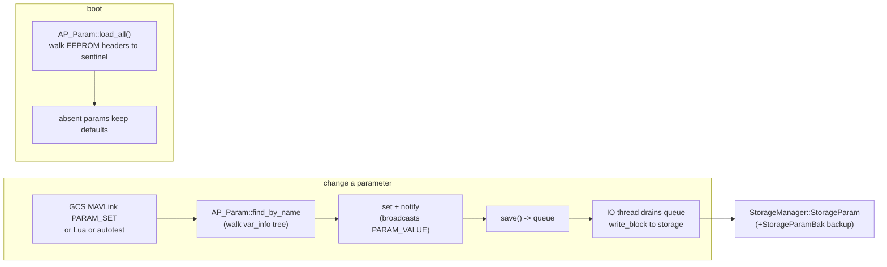
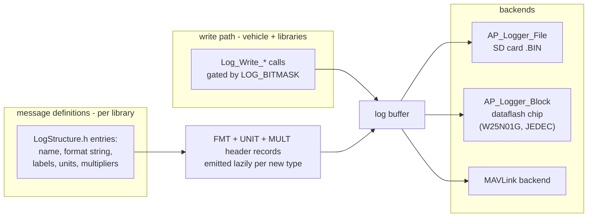
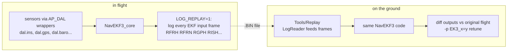

# 10 · Parameters, Storage & Logging

The `AP_Param` parameter system (the universal configuration interface), the `StorageManager` partition layer, dataflash logging with `AP_Logger`, flash filesystems, and deterministic replay.

**[← Back to index](../README.md)**

---

## Parameters — `AP_Param`

Almost every tunable value in ArduPilot is a *parameter*: an `AP_Float`, `AP_Int32`, … member of some class, registered in a static table. One declaration gives you: persisted storage, MAVLink read/write, ground-station documentation, and unit tests.

### Declaring parameters

```cpp
// in a library (e.g. libraries/AP_Baro/AP_Baro.cpp)
const AP_Param::GroupInfo AP_Baro::var_info[] = {
    AP_GROUPINFO("_GND_TEMP", 3, AP_Baro, _user_ground_temperature, 0),
    AP_GROUPINFO("_ALT_OFFSET", 5, AP_Baro, _alt_offset, 0),
    ...
    AP_GROUPEND
};

AP_Baro::AP_Baro() { AP_Param::setup_object_defaults(this, var_info); }
```

- `AP_GROUPINFO(name, idx, class, member, default)` stores a **byte offset** of the member inside its class (`AP_VAROFFSET` = `offsetof`) — no per-object registration, one table describes a whole tree.
- Vehicles declare the *root* table with `GSCALAR/GOBJECT/GOBJECTPTR` macros plus a `k_param_*` enum (`ArduCopter/Parameters.h`), and mount libraries under prefixes: e.g. `GOBJECT(BoardConfig, "BRD_", AP_BoardConfig)` → every `BoardConfig` param becomes `BRD_*`; `AP_SUBGROUPINFO(servo_channels, "SERVO", …, SRV_Channels)` → `SERVO1_FUNCTION`, `SERVO17_MIN`, …
- **Names are a runtime convention**: storage keys are a 9-bit top-level key + 18 bits of group ids (6 bits per nesting level, ≤3 levels). EEPROM never stores names — they're rebuilt by concatenating prefixes (`"SERVO" + "1_" + "FUNCTION"`). Max name 16 chars.
- Doctooling: `@Param/@DisplayName/@Description/@Units/@Range/@Values/@User/@RebootRequired` annotations above each entry generate the wiki/GCS metadata (`Tools/autotest/param_metadata/`). **`k_param` indices are frozen forever** — changing a key orphans every fielded config.

### Persistence path



- `AP_Param::setup()` checks the header ("AP" magic, format revision), wipes on mismatch, restores from the backup area (`StorageParamBak`) if primary is corrupt.
- `save_sync` skips writing values equal to default — the flash only stores deviations (an already-stored copy is rewritten, not erased).
- **Conversions**: when a table changes, `ConversionInfo{old_key, old_group_element, type, new_name}` tables + `convert_class` migrate old layouts across versions (`ArduCopter/Parameters.cpp:1277+`).
- A typical Copter exposes **~1,000–1,300** parameters, counted at runtime (`count_parameters()` ~30 ms on a Pixhawk).

## Storage — `StorageManager`

One manager, **fixed area layout**, versioned and backwards compatible (`libraries/StorageManager/StorageManager.cpp:38` "carefully designed"):

| Area | Used by |
|---|---|
| `StorageParam` | `AP_Param` values |
| `StorageParamBak` | param backup copy (FRAM/flash boards) |
| `StorageMission` | `AP_Mission` commands (15 B each + 4 B header) |
| `StorageRally` | `AP_Rally` points |
| `StorageFence` | `AC_PolyFence_loader` vertices |
| `StorageKeys` | `AP` mission/jump scratch, hw-specific keys |
| `StorageBindInfo` | binding data |
| `StorageCANDNA` | DroneCAN node ID allocation |

Each area is sliced per board from a `layout[]` table sized by `HAL_STORAGE_SIZE`; `StorageAccess` read/write helpers span multiple areas transparently; with SD support a `FileStorage` RAM cache + dirty-flush backs some regions.

### The layers under `hal.storage`

| Board storage | Mechanism |
|---|---|
| FRAM | `AP_RAMTRON` SPI FRAM — byte-writable, no erase |
| MCU internal flash | **`AP_FlashStorage`**: two-sector log-structured wear leveling — erase once, append change records over a `HAL_STORAGE_SIZE` (16 KiB) RAM image, switch+erase sectors when full (designed for 128 KiB sectors) |
| SD card | POSIX/file-backed (`USE_POSIX` in `AP_HAL_ChibiOS/Storage.cpp`) |
| no storage | `Empty::Storage` stubs |
| Linux/SITL | file-backed |

`AP_Filesystem` (`libraries/AP_Filesystem`) then exposes POSIX-ish APIs over per-path-prefix backends: `posix` (SITL/Linux/QURT), `FATFS` (ChibiOS SD), littlefs on NOR flash (`AP_Filesystem_FlashMemory_LittleFS`), `sys` (devices), plus `ROMFS` (see below). `AP_ROMFS` embeds tiny-inflated files into the firmware image at build time — Lua scripts (`ROMFS/scripts/*.lua`), OSD fonts, and `defaults/*.parm` parameter files for boards without filesystems.

## Logging — `AP_Logger` (the "dataflash")

`libraries/AP_Logger/` writes **self-describing binary** logs (`.BIN` files, named `%08u.BIN`, auto-started on arm):



- Format characters (`b B h H i I f d q Q L n N c C e E M Z…`) + per-field **units** and **multipliers** mean any tool (MAVExplorer, `Tools/Replay`, pyarrow-based readers) can decode any message without out-of-band knowledge.
- Rates: vehicles write attitude/IMU messages in fast tasks, slower streams (10/25 Hz) for navigation/GPS; `LOG_DISARMED`, `LOG_FILE_RATEMAX`, `LOG_FILE_DARM_RATEMAX`, `LOG_FILE_MB_FREE` control behavior.
- The `PARM` message records **every parameter change**; `MODE`, `EV`, `ERR` messages record mode changes and events — a flight log is a complete replayable narrative.

## Deterministic Replay — `AP_DAL` + `Tools/Replay`

The estimator stack is engineered so **any EKF run can be reproduced offline**:



`AP_DAL` (Data Abstraction Layer, `libraries/AP_DAL/`) wraps each sensor library the EKF3 touches; normally it's a pass-through, but it *frames* every access (start/end per filter update) so a log captures exactly what the filter saw, in order. `Tools/Replay` (`Replay.cpp`, `LogReader.cpp`) rebuilds a `ReplayVehicle` (an `AP_Vehicle` subclass!) and pumps those frames through the identical code path. This is the reason EKF3 code reads `dal.ins()` instead of `AP::ins()` — determinism is a *design constraint*, not an afterthought.

## Parameter Change Semantics

- Most params take effect **next loop read** (code polls members directly) — no publish/subscribe.
- `@RebootRequired` params are only staged at set and applied on boot (checked via `ap.param_reboot` flags).
- GCS `PARAM_SET` → `find_by_name` → `set_float` → `save()` (queued, IO thread) → broadcast `PARAM_VALUE` on **all** links → `PARM` log entry.
- `AP_PARAM_FLAG_ENABLE` rows can hide/show whole subtrees when a "master" param changes (e.g. `SERVOx_FUNCTION=0` hides the rest of that channel's params from the GCS).

## Navigation

**[← Back to index](../README.md)** · Previous: [09 · Missions & Autonomy](09-missions-and-autonomy.md) · Next: [11 · Scripting, UI & Peripherals](11-scripting-interfaces-peripherals.md)