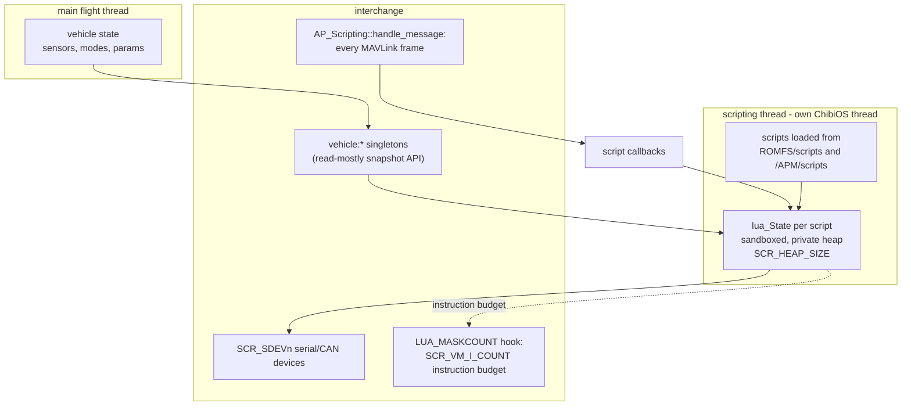
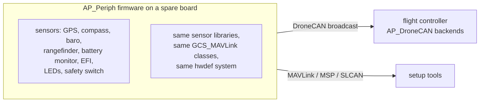

# 11 · Scripting, UI & Peripherals

Extending ArduPilot without recompiling: the embedded Lua VM, `AP_Module` native hooks, user interfaces (notify LEDs/displays/OSD), external estimators/controllers, and the `AP_Periph` CAN peripheral firmware.

**[← Back to index](../README.md)**

---

## Lua Scripting — `AP_Scripting`

[`libraries/AP_Scripting/`](https://github.com/ArduPilot/ardupilot/tree/e96bd9053e/libraries/AP_Scripting) embeds **Lua 5.3.6** ([`lua/src`](https://github.com/ArduPilot/ardupilot/tree/e96bd9053e/libraries/AP_Scripting/lua/src), vendored) plus a **generated binding layer** — the C++↔Lua API is *code-generated* from [`generator/description/bindings.desc`](https://github.com/ArduPilot/ardupilot/blob/e96bd9053e/libraries/AP_Scripting/generator/description/bindings.desc) into [`lua_bindings.cpp`](https://github.com/ArduPilot/ardupilot/blob/e96bd9053e/libraries/AP_Scripting/lua_bindings.cpp), not hand-written. Regenerate with:

```bash
python3 libraries/AP_Scripting/generator/generator.py \
    -i libraries/AP_Scripting/generator/description/bindings.desc \
    -o /tmp/lua_generated_bindings -d /tmp/generated_docs.lua
```

(the waf build re-runs the generator automatically when [`bindings.desc`](https://github.com/ArduPilot/ardupilot/blob/e96bd9053e/libraries/AP_Scripting/generator/description/bindings.desc) changes).

### Runtime shape



- **Isolation**: scripts run in a dedicated thread (`thread_create`, stack ~17 KiB) at a configurable priority (`SCR_THD_PRIORITY`), each script in its own `lua_State` with its own heap. They **cannot** starve the flight loop; a VM instruction-count hook (`lua_sethook`, `SCR_VM_I_COUNT` default 10k instructions) yields runaway scripts.
- **Cooperative model**: scripts are *resumed*; the `update` function convention (returning `update, 1000` style) makes them tick-based coroutines, not busy loops.
- **Loading**: `@ROMFS/scripts` (embedded applets) + `/APM/scripts` on SD (`./scripts` on SITL); optional checksums (`SCR_RUN_CHECKSUM`) gate what runs; `SCR_*` params control heap size (43–200 KiB by board class), thread priority, and whether vehicle `set_mode`/arming hooks are exposed.
- **API surface** (generated, so always current): vehicle state (ahrs, battery, GPS), param read/set, `gcs:send_text` / MAVLink send, serial & CAN device drivers (`SCR_SDEVn_*`), LED control, RC override, mode/arming hooks. **161 example scripts** in [`libraries/AP_Scripting/examples/`](https://github.com/ArduPilot/ardupilot/tree/e96bd9053e/libraries/AP_Scripting/examples) (applets, drivers for EFI/LTE/…, camera control), plus [`docs/docs.lua`](https://github.com/ArduPilot/ardupilot/blob/e96bd9053e/libraries/AP_Scripting/docs/docs.lua) generating API docs.

**What this buys**: driver-level extensions (new sensors over I2C/SERIAL/CAN), mission-time behaviors (`NAV_SCRIPT_TIME` mission commands), failsafes, tuning UIs — all field-updatable, all safe.

## Native Modules — `AP_Module`

[`libraries/AP_Module/`](https://github.com/ArduPilot/ardupilot/tree/e96bd9053e/libraries/AP_Module) is the (experimental, Linux-target) escape hatch for compiled extensions: a vehicle loads a `.so`, `dlsym`s versioned hooks (`ap_hook_setup_start`, `ap_hook_AHRS_update`, `ap_hook_gyro_sample`, …), and calls them synchronously in the loop. Data crosses via plain-C versioned structs ([`AP_Module_Structures.h`](https://github.com/ArduPilot/ardupilot/blob/e96bd9053e/libraries/AP_Module/AP_Module_Structures.h)). Rarely used; Lua covers most cases.

## User Interfaces

### `AP_Notify` — lights, buzzers, displays

Frontend + `NotifyDevice` backends, driven by events (armed, GPS state, EKF pos hold…):

| Backend family | Examples |
|---|---|
| LEDs | `RGBLed` family (board LED, RCOutput LED via DShot, external, OreoLED, Toshiba, PCA9685, DroneCAN RGB, ProFiLED…) and serial NeoPixel/WS2812 |
| Audio | `ToneAlarm` (board buzzer with melody patterns), `MMLPlayer` |
| Displays | SSD1306/SH1106 I²C OLED status displays |
| Other | external LEDs, `ScriptingLED` (script-driven), SITL window LEDs |

The notify flags stream (`AP_Notify::update`) is what blinks "GPS 3D + EKF good" patterns; a green-solid-armed copter is `AP_Notify` doing its job.

### `AP_OSD` — on-screen display

Frontend + backends (`AP_OSD_Backend`) selected by `OSD_TYPE` (`osd_types` enum, [`AP_OSD.h:549`](https://github.com/ArduPilot/ardupilot/blob/e96bd9053e/libraries/AP_OSD/AP_OSD.h#L549): `OSD_NONE=0, OSD_MAX7456=1, OSD_SITL=2, OSD_MSP=3, OSD_TXONLY=4, OSD_MSP_DISPLAYPORT=5`): **MAX7456** (analog video overlay chip), **MSP** (Betaflight/INAV OSD protocol), **MSP DisplayPort** (DJI Goggles), SITL. Screens (layout sets) with per-item `OSD*` params (position, enabled), symbolic fonts (ROMFS-embedded), plus `AP_VideoTX` integration showing band/channel/power on screen.

### `AP_VideoTX` + serial VTX protocols

Analog VTX model driven over **SmartAudio** (`AP_SmartAudio`) or **Tramp** (`AP_Tramp`) serial protocols (both live in [`libraries/AP_VideoTX`](https://github.com/ArduPilot/ardupilot/tree/e96bd9053e/libraries/AP_VideoTX); also CRSF passthrough) — band/channel/power/pitmode with parameter persistence.

## External Estimators & Controllers

| Library | Purpose |
|---|---|
| `AP_ExternalAHRS` | serial **third-party AHRS/INS** units (VectorNav, MicroStrain, SBG, InertialLabs, Trimble GSOF…) — their data *re-enters* the normal stack through pseudo-sensor backends (`AP_InertialSensor_ExternalAHRS`, `AP_Compass_ExternalAHRS`, `AP_Baro_ExternalAHRS`, `AP_GPS_ExternalAHRS`) or `AP_AHRS_External` |
| `AP_ExternalControl` | companion-computer control (ROS etc.): velocity/yaw/position targets via MAVLink, per-vehicle subclasses (`AP_ExternalControl_Copter`, `_Plane`, `_Rover`) |
| `AP_Follow` | follow-me target ingestion (see [09](09-missions-and-autonomy.md)) |

## `AP_Periph` — the CAN Peripheral Firmware

[`Tools/AP_Periph/`](https://github.com/ArduPilot/ardupilot/tree/e96bd9053e/Tools/AP_Periph) is a *separate* firmware (built by the same waf: `./waf configure --board CubeOrange-periph && ./waf AP_Periph`) that turns a supported flight-controller board into a **DroneCAN peripheral node**:



It reuses the *same* sensor frontends and GCS classes as vehicle firmware (that's why `AP_HAL` has `sitl_periph_*` targets), broadcasts sensor data as DroneCAN messages, handles DNA allocation, and supports firmware updates over CAN ([`can.cpp`](https://github.com/ArduPilot/ardupilot/blob/e96bd9053e/Tools/AP_Periph/can.cpp)). This is ArduPilot's answer to "smart sensors": the architecture exports itself.

## Honorable Mentions (library tour)

The [`libraries/`](https://github.com/ArduPilot/ardupilot/tree/e96bd9053e/libraries) tree has ~155 members; these appear in no other chapter but are frequently met:

| Library | What |
|---|---|
| `AP_BattMonitor` | battery backends: analog, SMBus/I2C (Solo), DroneCAN, ESC telemetry, generators/EFI |
| `AP_Generator` / `AP_EFI` | generator & electronic fuel injection state |
| `AP_RSSI` | receiver signal strength from many sources |
| `AP_RPM` | RPM sensors (piston/rotor hours) |
| `AP_Button` | on-board button handling (`BTN_PIN*`) |
| `AP_JSButton` | FrSKY/BlueJoystick buttons |
| `AP_Lighting`/`AP_SerialLED` | LED strips |
| `AP_Networking` | WiFi/Ethernet (UDP/TCP `NET_*`) |
| `AP_DDS` | **ROS 2** over Micro-CDR/XRCE-DDS (px4 ROS2 bridge style) |
| `AP_OpenDroneID` | remote ID broadcast (Bluetooth/WiFi/DroneCAN modules) |
| `AP_Fence`/`AP_Avoidance` wiring | see [09](09-missions-and-autonomy.md) |
| `AP_BLHeli` | BLHeli pass-through ESC configuration |
| `AP_ESC_Telem` | telemetry from BLHeli/DEO/KDE ESCs (also feeds dynamic notch!) |
| `AP_Airspeed`, `AP_Landing`, `AP_Soaring`, `AP_WindVane` | fixed-wing helpers |
| `AP_LandingGear`, `AP_Parachute`, `AP_Gripper`, `AP_Winch` | payloads |
| `AP_OpticalFlow`, `AP_VisualOdom`, `AP_WheelEncoder`, `AP_Beacon`, `AP_IRLock`, `AP_Proximity`, `AP_SurfaceDistance` | navigation sensors feeding EKF3/OA ([06](06-sensors-and-state-estimation.md)) |
| [`Filter/`](https://github.com/ArduPilot/ardupilot/tree/e96bd9053e/libraries/Filter) | `LowPassFilter`, `NotchFilter`, `HarmonicNotchFilter`, `SlewLimiter`, `LinearSlewRateLimiter`… — the filter toolbox used by sensors & controllers |
| [`AP_Math/`](https://github.com/ArduPilot/ardupilot/tree/e96bd9053e/libraries/AP_Math) | `Vector2/3f`, `Matrix3`, `Quaternion`, `Location`, `AP_Trige`… — the numeric backbone; well unit-tested |
| `GCS_MAVLink` | see [08](08-gcs-and-communications.md) |
| `AP_BoardConfig` | `BRD_*`: the board "options" row (CAN, watchdog, safety, IO MCU, IMU heater) |
| `AP_IOMCU` | the Pixhawk I/O co-processor protocol (firmware in [`iofirmware/`](https://github.com/ArduPilot/ardupilot/tree/e96bd9053e/libraries/AP_IOMCU/iofirmware)) — RC in, PWM out on px4-v1-class boards |

## Navigation

**[← Back to index](../README.md)** · Previous: [10 · Parameters & Logging](10-parameters-storage-logging.md) · Next: [12 · Build System & Testing](12-build-system-and-testing.md)