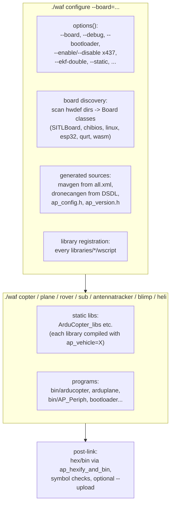

# 12 · Build System & Testing

How ~155 libraries become six vehicle firmwares and ~500 board targets: the waf build, board definitions as data, generated protocol code, SITL, the autotest integration framework, unit tests, and CI.

**[← Back to index](../README.md)**

---

## The Build System — Python [`waf`](https://github.com/ArduPilot/ardupilot/blob/e96bd9053e/waf)

ArduPilot builds with a **customized waf** ([`modules/waf`](https://github.com/ArduPilot/waf/tree/35eadbb64e2052099a853b571e507c33032b392c) submodule, wrapped by the [`waf`](https://github.com/ArduPilot/ardupilot/blob/e96bd9053e/waf) script) plus ArduPilot extensions in [`Tools/ardupilotwaf/`](https://github.com/ArduPilot/ardupilot/tree/e96bd9053e/Tools/ardupilotwaf). The old Makefile build is gone. The language standard is fixed by the build: C++ is compiled with **`-std=gnu++11`** and C with `-std=c11` ([`Tools/ardupilotwaf/boards.py:437/1308`](https://github.com/ArduPilot/ardupilot/blob/e96bd9053e/Tools/ardupilotwaf/boards.py#L437)) — no C++14/17 anywhere in the tree.



### Boards are data

Every directory with an `hwdef.dat` under `libraries/AP_HAL_*/hwdef/` becomes a board at configure time: **460 ChibiOS** targets, 25 Linux, 10 SITL, 10 ESP32, 2 QURT (~507 total). A new board = a new data file ([`libraries/AP_HAL_ChibiOS/hwdef/scripts/chibios_hwdef.py`](https://github.com/ArduPilot/ardupilot/blob/e96bd9053e/libraries/AP_HAL_ChibiOS/hwdef/scripts/chibios_hwdef.py) generates `hwdef.h` — pins, serial order, SPI devices, ADC scales, thread tweaks). `--board=sitl` (default) is just another entry.

### The per-vehicle composition ([`ArduCopter/wscript`](https://github.com/ArduPilot/ardupilot/blob/e96bd9053e/ArduCopter/wscript))

```python
bld.ap_stlib(name='ArduCopter_libs',
              ap_vehicle='ArduCopter',
              ap_libraries=bld.ap_common_vehicle_libraries() + [
                  'AC_AttitudeControl', 'AC_WPNav', 'AC_Autorotation', 'AP_Motors', ...])
bld.ap_program(program_name='arducopter',
               program_groups=['bin', 'copter'],
               use='ArduCopter_libs',
               defines=['FRAME_CONFIG=MULTICOPTER_FRAME'])
```

- `./waf copter` is a **group query**: "build every program tagged `copter`" (that's `arducopter`; `heli` similarly maps to `arducopter-heli`, same libs, different `FRAME_CONFIG`).
- Libraries compiled in `ap_vehicle=ArduCopter` context carry vehicle defines (`AP_VEHICLE` macros, `MODE_*_ENABLED` sets) — the "specialize libraries per vehicle at compile time" mechanism from [01](01-architecture-overview.md).
- `--enable/--disable` options (~437, generated from [`Tools/scripts/build_options.py`](https://github.com/ArduPilot/ardupilot/blob/e96bd9053e/Tools/scripts/build_options.py)) flip `AP_*_ENABLED` defines inside a per-board `ap_config.h` that is **force-included** into every translation unit. Core code must build with everything disabled.
- Protocol stacks are **generated inside the build**: MAVLink C headers (`mavgen` from [`all.xml`](https://github.com/ArduPilot/mavlink/blob/e03dad40efb3a4009ad6d78de5e55997139ac2f3/message_definitions/v1.0/all.xml)), DroneCAN/libcanard code (`dronecangen` from DSDL). No generated files are committed.
- A generic `ap` static lib (`ap_vehicle='UNKNOWN'`, globbing all libraries) is what examples/tests link via `use='ap'` — the reason every `libraries/<lib>/tests/wscript` looks the same.

Build outputs land in `build/<board>/bin/<program>`. `--upload` pushes over USB (or BlueOS). `--bootloader` switches the tree to building [`Tools/AP_Bootloader`](https://github.com/ArduPilot/ardupilot/tree/e96bd9053e/Tools/AP_Bootloader).

## SITL — Software In The Loop

`--board=sitl` produces a **native binary** with `AP_HAL_SITL` and physics from [`libraries/SITL/`](https://github.com/ArduPilot/ardupilot/tree/e96bd9053e/libraries/SITL) (163 `SIM_*.cpp` model files):

- vehicle models: `SIM_Multirotor`, `SIM_Plane`/JSBSim bridge, `SIM_Rover`, `SIM_Submarine`, Gazebo/AirSim bridges, `SIM_Blimp`, `SIM_BalanceBot`, `SIM_Sailboat`…
- sensor models: `SIM_GPS` (constellations, RTK), `SIM_Baro`, `SIM_Compass`, `SIM_Rangefinder`, `SIM_OptiFlow`, and *failure injection* (motor failures, gyro drift, wind, GPS glitches — the `SIM_*_ENABLE` params).

[`Tools/autotest/sim_vehicle.py`](https://github.com/ArduPilot/ardupilot/blob/e96bd9053e/Tools/autotest/sim_vehicle.py) wraps configure/build/run (`-f quad`, `--console`, `--map`, gdb/valgrind/ASan switches) and starts MAVProxy. Default MAVLink endpoint: `tcp::5760`; simulator state via UDP. Because SITL runs the *real* vehicle code, it's the primary development and CI vehicle.

## Testing

### Unit tests (`libraries/<lib>/tests/`)

googletest-based, built and run with:

```bash
./waf configure --board sitl && ./waf check        # or ./waf check --alltests (BUILD.md:353)
./waf --targets tests/test_math                  # single test binary (BUILD.md:169)
```

27 test directories exist (`AP_Math`, `AP_Baro`, `AP_GPS`, `SITL`, `Filter`, `AP_Param`, `AP_RCProtocol`, …). Tests link the catch-all `ap` lib, so they exercise library code exactly as compiled for `UNKNOWN` vehicles — plus `SITL`-based tests run the sim.

### Autotest — integration suite ([`Tools/autotest/`](https://github.com/ArduPilot/ardupilot/tree/e96bd9053e/Tools/autotest))

Python + pymavlink + MAVProxy drives a full SITL vehicle through real missions and maneuvers:

```bash
Tools/autotest/autotest.py build.Copter test.Copter.RTLYaw
```

- suites per vehicle ([`arducopter.py`](https://github.com/ArduPilot/ardupilot/blob/e96bd9053e/Tools/autotest/arducopter.py), [`arduplane.py`](https://github.com/ArduPilot/ardupilot/blob/e96bd9053e/Tools/autotest/arduplane.py), [`rover.py`](https://github.com/ArduPilot/ardupilot/blob/e96bd9053e/Tools/autotest/rover.py), [`ardusub.py`](https://github.com/ArduPilot/ardupilot/blob/e96bd9053e/Tools/autotest/ardusub.py), …) — ~160 test classes: autoland, RTL, EKF failsafes, paratrooper… ; junit XML output
- vehicle variety: Sub, Copter, Plane, Tracker, Rover, QuadPlane, BalanceBot, Helicopter, Sailboat, Blimp
- same harness runs the same tests against **real hardware** builds for HIL-style checks

### Replay

[`Tools/Replay`](https://github.com/ArduPilot/ardupilot/tree/e96bd9053e/Tools/Replay) re-runs EKF3 deterministically from logs (see [10](10-parameters-storage-logging.md)) — used both as a test (regression diffs of estimator outputs, [`check_replay_branch.py`](https://github.com/ArduPilot/ardupilot/blob/e96bd9053e/Tools/Replay/check_replay_branch.py)) and as a tuning tool.

### Static & CI

34 GitHub workflows compile the matrix: per-vehicle SITL tests (sharded), unit tests (gcc+clang × configs: unit-tests, examples, ASan), ChibiOS targets (`CubeOrange`, `fmuv3`, bootloaders, periph, IO firmware…), ESP32, QURT, Cygwin/macOS/Linux boards, [`test_size.yml`](https://github.com/ArduPilot/ardupilot/blob/e96bd9053e/.github/workflows/test_size.yml) (**binary size ratchet**), [`test_scripting`](https://github.com/ArduPilot/ardupilot/blob/e96bd9053e/.github/workflows/test_scripting.yml), [`test_dds`](https://github.com/ArduPilot/ardupilot/blob/e96bd9053e/.github/workflows/test_dds.yml) (ROS2), [`test_renode`](https://github.com/ArduPilot/ardupilot/blob/e96bd9053e/.github/workflows/test_renode.yml) (HW-in-loop emulation), [`test_clang_scan_build`](https://github.com/ArduPilot/ardupilot/blob/e96bd9053e/.github/workflows/test_clang_scan_build.yml) (static analysis), plus style/pre-commit (`pre-commit`, copyright & `Subsystem:` commit-prefix conventions via [`Tools/scripts/check_branch_conventions.py`](https://github.com/ArduPilot/ardupilot/blob/e96bd9053e/Tools/scripts/check_branch_conventions.py)).

## Developer Workflow Cheat Sheet

```bash
# build & run a copter in SITL
Tools/autotest/sim_vehicle.py -v copter --console --map

# build for real hardware
./waf configure --board CubeOrange && ./waf copter    # then ./waf copter --upload

# unit tests
./waf configure --board sitl && ./waf check

# integration test
Tools/autotest/autotest.py build.Copter test.Copter.Autotune

# add a build option: edit Tools/scripts/build_options.py (Feature list)
# add a board: libraries/AP_HAL_ChibiOS/hwdef/<NewBoard>/hwdef.dat (+ .chip, .chibios board files)

# regenerate Lua bindings (waf re-runs it automatically, too)
python3 libraries/AP_Scripting/generator/generator.py \
    -i libraries/AP_Scripting/generator/description/bindings.desc \
    -o /tmp/lua_generated_bindings -d /tmp/generated_docs.lua
```

## Contribution Conventions (from the repo's own docs)

- Commit messages prefixed with a **subsystem tag** (`libraries: …`, `ArduCopter: …`, `Tools: …`) — enforced by CI.
- `AGENTS.md`/`CONTRIBUTING.md` at the root: style (clang-format config), param docs annotations, `k_param` index freeze, storage-layout freeze.
- Every PR runs the size ratchet + at least one SITL vehicle build matrix slice.

## Navigation

**[← Back to index](../README.md)** · Previous: [11 · Scripting & Peripherals](11-scripting-interfaces-peripherals.md)